<p align="center">
  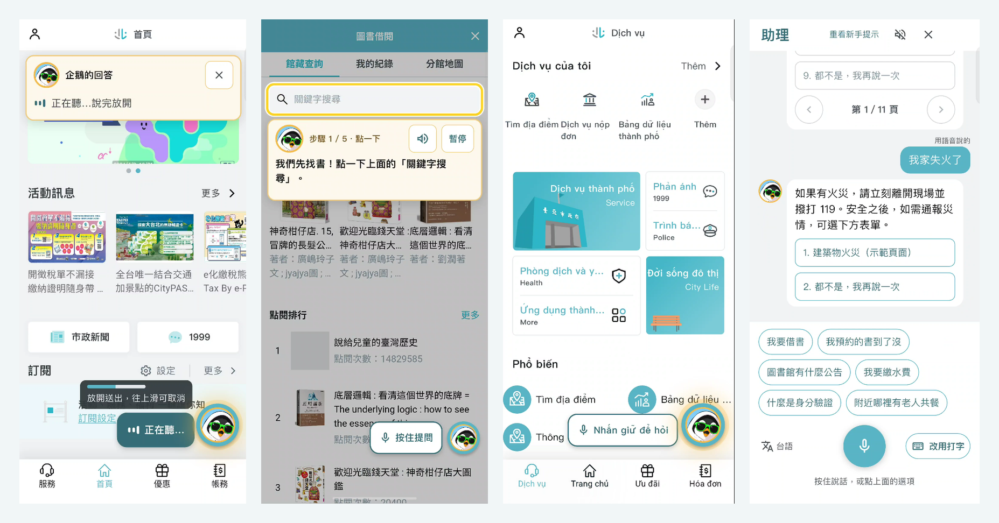
</p>

<h1 align="center">台北一點就通！微服務入口整合助理</h1>

<p align="center">
  <b>TownPass 地端 AI 助理：全部在手機上跑，說一句話，就幫你打開對的台北通服務。</b><br>
  中文 · 台語 · 英文 · 日文 · 越南文 · 印尼文 · 泰文 ｜ 沒有雲端模型，錄音不離開手機。
</p>

<p align="center">
  <code>Flutter 3.47.6</code> ·
  <code>Android 實機</code> ·
  <code>llama.cpp + whisper.cpp</code> ·
  <code>Chaquopy Python</code> ·
  <code>GPL-3.0</code>
</p>

> 本專案是台北市政府開源的 [TownPass（台北通）](https://github.com/taipei-doit/TownPass) App 的 fork，
> 在官方 App 架構上加了一個離線的 AI 助理。官方專案說明見 [docs/UPSTREAM_README.md](docs/UPSTREAM_README.md)，
> 改程式之前請先讀 [AGENTS.md](AGENTS.md)。

**English summary.** This fork of Taipei City Government's open-source TownPass app adds a municipal-service
assistant that runs entirely on the phone: no cloud model, and recordings never leave the device. You speak
(Mandarin, Taiwanese Hokkien, English, Japanese, Vietnamese, Indonesian or Thai) or type; a 0.2-second language
gate (Whisper tiny) picks the recogniser (Whisper small, Breeze-ASR-26 for Taiwanese, PhoWhisper for Vietnamese);
a rule-first pipeline (emergency words, commands, keyword search, a grammar-constrained Ministral 3B / Gemma 4 E2B
choice, phonetic and e5 semantic matching, then 8,121 Taipei City FAQ entries) opens the right TownPass service
page, lists options or answers; and a guided mode (penguin, task cards, highlight halos, hold-to-speak form filling)
walks you through the real service page, which is translated on the fly. On the computer evaluation sets it scores
187–188/190 (dev), 97/102 (held-out) and 46/46 (five foreign languages) with zero wrong pages opened.
Built with Flutter 3.47.6, a Chaquopy-embedded Python backend, llama.cpp and whisper.cpp on Android; GPL-3.0.
Developer guide: [ASSISTANT_README.md](ASSISTANT_README.md).

## 目錄

- [為什麼做這件事](#為什麼做這件事)
- [功能亮點](#功能亮點)
- [架構](#架構)
- [技術與模型](#技術與模型)
- [數字](#數字)
- [怎麼跑](#怎麼跑)
- [專案結構](#專案結構)
- [文件索引](#文件索引)
- [團隊](#團隊)
- [授權](#授權)
- [致謝](#致謝)

## 為什麼做這件事

台北通有上百項服務，但很多人不是找不到服務，是找不到**選單**：

- **長輩**：看不清小字、不知道「繳費」在哪一層、不習慣打字，但很會講。
- **移工、新住民、旅客**：介面是中文，服務名稱更是中文；就算會一點中文，也不知道「規費」「巨大垃圾」是什麼。
- **第一次用的人**：知道要借書，卻不知道借書要先搜尋、選分館、再預約。

所以我們把助理做成「用講的」：按住說一句話，助理直接打開對的頁面，必要時一步步教你在**真正的服務頁面**上操作，
頁面文字也翻成你講的語言。而且全部在手機上跑：

- **離線**：決策模型、語音辨識、向量檢索、頁面翻譯都在裝置上；網路只用來抓資料（圖書館藏、台北通常見問答）和第一次下載 ML Kit 翻譯檔。
- **隱私**：錄音不存檔、不上傳；填欄位時講的內容不進對話紀錄、不送決策模型。
- **不越權**：不自動送出、付款、撥號、預約；開頁只是打開原本的頁面，模型輸出一律經驗證才會變成動作。

## 功能亮點

### 1. 說話就開服務

<table>
  <tr>
    <td width="33%">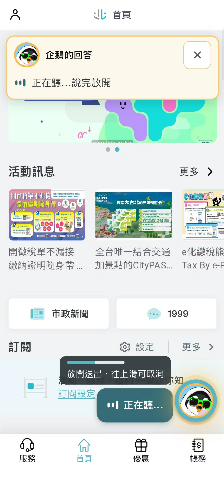</td>
    <td width="33%">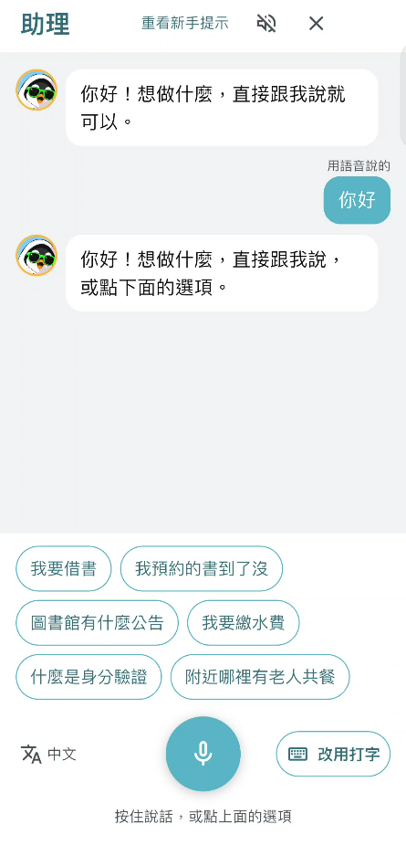</td>
    <td valign="top">
      <ul>
        <li>每個畫面都有「<b>按住提問</b>」：按住說、放開送出、往上滑取消，有音量條。</li>
        <li>「我要繳水費」「我家前面路燈壞了」「我欲借冊」→ 直接打開對應的服務頁面；<b>只有一個明確的選項就直接開，有多個才讓你選</b>。</li>
        <li>「有哪些功能」→ 列出可用服務，◀ ▶ 換頁，說「第二個」就選。</li>
        <li>聽不清楚時直接用最可能的讀法，不再反問「是這句嗎？」。</li>
        <li>也可以打字；建議句會換成你最近真的用過的請求。</li>
      </ul>
    </td>
  </tr>
</table>

### 2. 引導教學：企鵝、任務卡、光圈

<table>
  <tr>
    <td width="25%">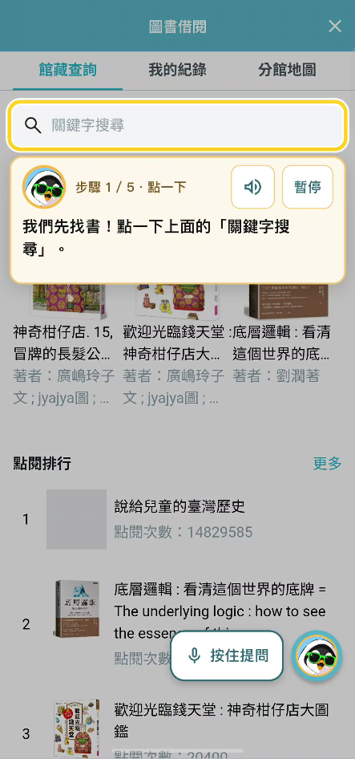</td>
    <td width="25%">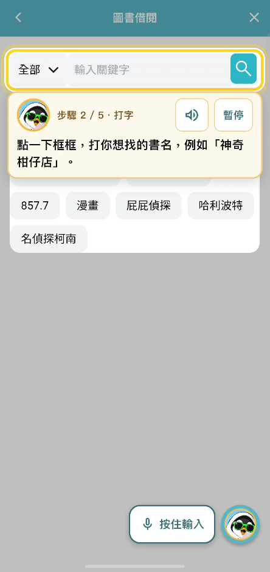</td>
    <td width="25%">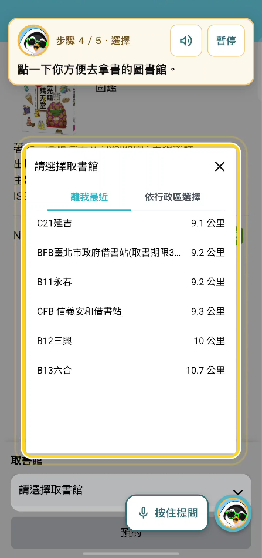</td>
    <td width="25%">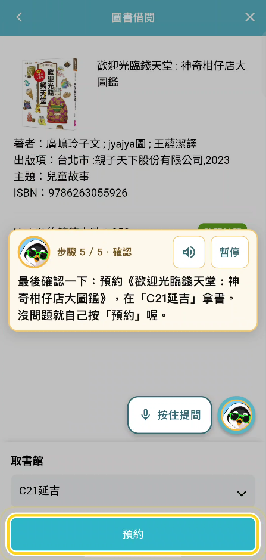</td>
  </tr>
</table>

- 預設介面就是引導模式：企鵝的**任務卡**寫這一步要做什麼、**光圈**標出要按的地方、可以朗讀或暫停，在**真實的官方服務頁面**上教學（頁面不修改、不打包，用網頁自己的換頁機制在頁內切換）。
- 教學要填欄位時，「按住提問」變成「**按住輸入**」：用講的說電話號碼，就轉成數字填進欄位，依欄位型別轉格式（電話、Email、金額、日期、時間、身分證、車牌、文字），可以「復原」，**不會按送出**。
- 最後一步永遠是使用者自己按；完成後企鵝會說明「這是示範網站，沒有真的送出」。
- 教學流程以 `tool/guide_audit/` 在示範網站錄製 177 條重播驗證；教學文字 1,132 句，6 種語言。

<details>
<summary>完整的圖書借閱 5 步驟（7 張截圖）</summary>
<table>
  <tr>
    <td width="25%"><br><sub>1. 點一下搜尋</sub></td>
    <td width="25%"><br><sub>2. 打書名（或按住輸入）</sub></td>
    <td width="25%">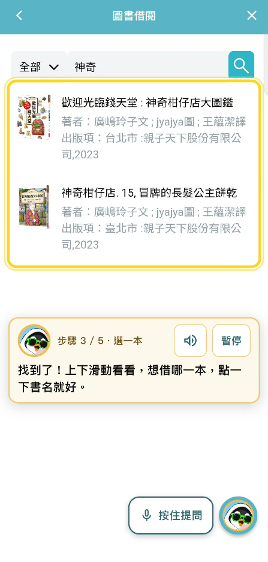<br><sub>3. 選一本</sub></td>
    <td width="25%">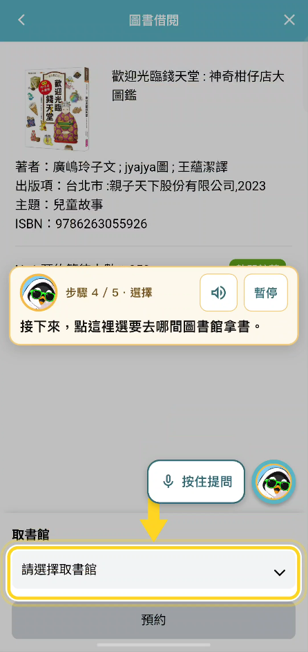<br><sub>4a. 找到取書館欄位</sub></td>
  </tr>
  <tr>
    <td><br><sub>4b. 選分館</sub></td>
    <td><br><sub>5. 自己按「預約」</sub></td>
    <td>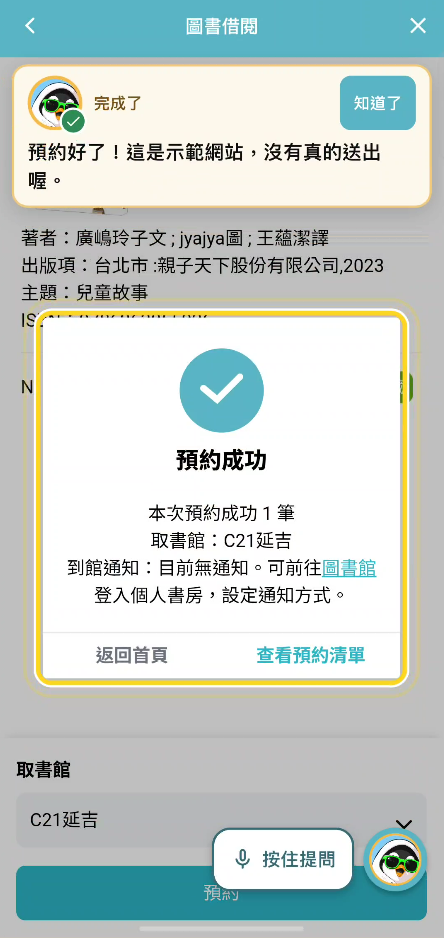<br><sub>完成</sub></td>
    <td></td>
  </tr>
</table>
</details>

### 3. 台語自動辨識

<table>
  <tr>
    <td width="33%">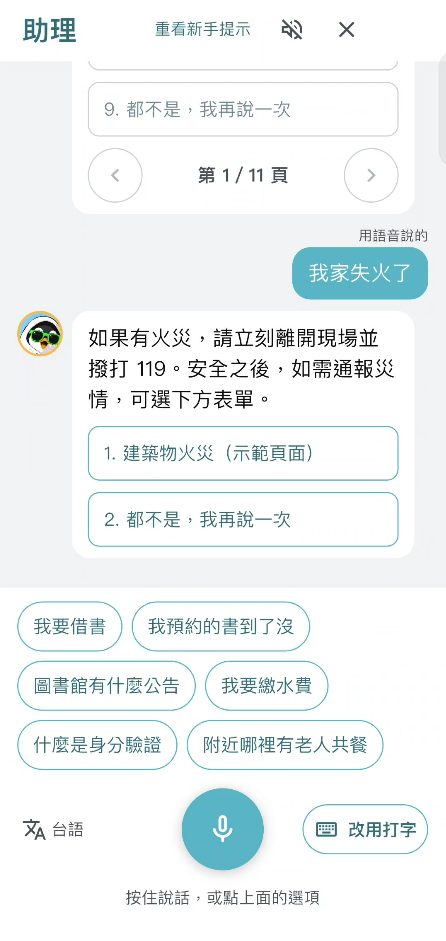</td>
    <td valign="top">
      <ul>
        <li>台語<b>不用切選單</b>：語言判斷模型（Whisper tiny）回傳 99 種語言的機率，台語的分布和華語不一樣，我們在上面加了一個 104 個係數的小分類器；分數夠高就交給台語模型。</li>
        <li>閘門漏掉的，用文字再補：中文結果<b>不像華語</b>（台灣華語字元 bigram 模型）或 <b>App 認不出那句話</b>，就交給台語模型再聽一次，留比較好的那份。</li>
        <li>台語模型是聯發科技研究中心＋陽明交大的 <b>Breeze-ASR-26</b>（Apache-2.0），第一次用到才載入；輸出中文字，之後走原本的中文流程。</li>
        <li>手動「台語（測試）」選項保留；第一次在中文手機打開助理時會大字問「您是否為台語用戶？」。</li>
        <li>限制：目前只有辨識，朗讀用中文。</li>
      </ul>
    </td>
  </tr>
</table>

### 4. 多語＋頁面即時翻譯

<table>
  <tr>
    <td width="33%">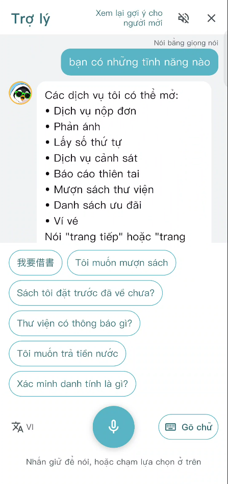</td>
    <td width="33%">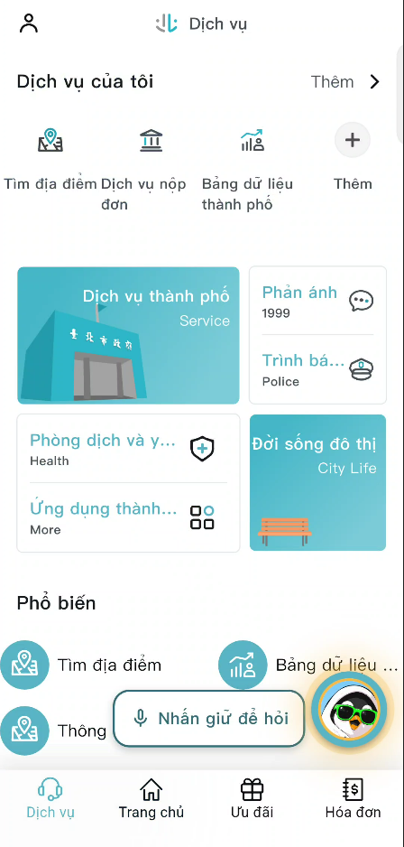</td>
    <td valign="top">
      <ul>
        <li>講什麼語言，<b>助理文字、建議句、教學卡片、按鈕、設定頁、App 畫面與服務網頁一起換</b>；語音判斷把握 ≥ 0.8 才改選單並記住。</li>
        <li>頁面翻譯：預翻好的字串直接用（<code>assets/i18n/app_strings.json</code>），其餘用 Google ML Kit 離線翻譯，一次 20 句；翻譯時保留原文，教學光圈用原文找按鈕。</li>
        <li><b>不強制用使用者沒講的語言解碼</b>（強制會讓 Whisper 把日文「翻」成中文）；不確定時把最可能的兩、三種語言各聽一次，留字體符合、清楚、分數高的那份。</li>
        <li>越南文專用 <b>PhoWhisper</b>（VinAI，BSD-3）；比對不打聲調、聲調聽錯、南北口音（d/gi/r/v、ch/tr、s/x、字尾 n/ng）都能對到。</li>
        <li>外語標題與關鍵字 5 種語言、口語例句 464 句；外語 FAQ 先翻成中文再查，答案再翻回來。</li>
      </ul>
    </td>
  </tr>
</table>

### 5. 市府 FAQ

<table>
  <tr>
    <td width="33%">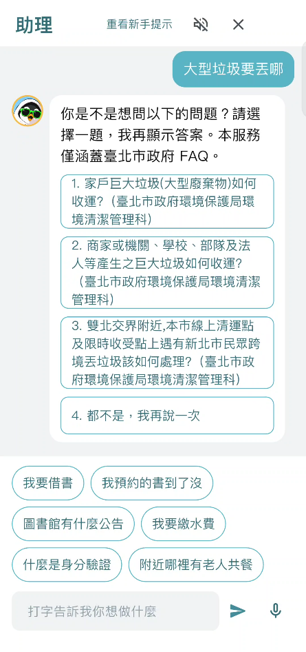</td>
    <td valign="top">
      <ul>
        <li>「大包垃圾要怎麼丟」「身分證掉了怎麼辦」→ 從<b>市府 FAQ 8,121 筆</b>（e5 向量，手機上 22 MB 索引）和台北通常見問答找答案。資料來源：臺北市資料大平台〈<a href="https://data.taipei/dataset/detail?id=203f1657-bb4a-45a7-b25f-279b63136645">臺北市市政網站整合平台之常見問答</a>〉。</li>
        <li>查詢前先把口語詞補成 FAQ 用詞：大包垃圾／舊家具 → 巨大垃圾 大型廢棄物；身分證掉了 → 遺失 補發；敬老卡 → 敬老悠遊卡。</li>
        <li>cosine ≥ 0.915 直接回答；≥ 0.88 列出最接近的問題讓使用者選；以下不回，不亂答。答案超過 600 字截斷並提示洽 1999。</li>
      </ul>
    </td>
  </tr>
</table>

### 6. 緊急回應

- 失火、冒煙、受困、倒地、沒呼吸、自殺、家暴、性侵、跟蹤等詞表（6 種語言），**在所有檢索、FAQ、模型之前**直接回 119／1925／1995／113／110（上面第 3 點的截圖就是「我家失火了」）。
- 失火只**列出**災情表單讓使用者選，不自己打開；「防火宣導、火災保險、演習、以前…」排除。
- 不經模型，所以不會慢、不會被模型想歪。

## 架構

手機（Android，建議 12 GB 記憶體）上有一個 Flutter App、一個 Python 後端和六個模型伺服器，全部綁在 `127.0.0.1`。
App 只直接連後端 `:8765`。

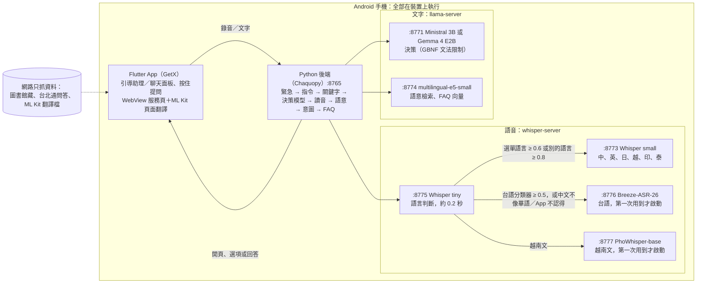

**一句話的旅程**


1. **錄音 → 語言判斷 → 辨識**：tiny 先判斷語言（0.2 秒），再用該語言的模型聽成文字。台語不用切選單：閘門分類器、或「中文不像華語／App 認不出」時交給 Breeze 再聽一次。
2. **文字 → 決定**：後端依序找：緊急詞 → 取消／換頁／第幾個 → 功能關鍵字 → 決策模型在 A／B／C 候選中選一個（GBNF 文法硬性限制，只能輸出 `{"choice":"X"}`，6 個 token）→ 讀音相似（Unihan 台灣讀音，折疊 zh/z、l/n、ing/in 等）→ 語意相似（e5 ＋ 464 句口語例句）→ 問模型意圖 → FAQ。都沒有就說沒找到，**不開頁**。
3. **決定 → 畫面**：App 打開頁面、列出選項或回答；模型選項之外的任何輸出都被 `validate_call` 擋下，候選 ID 與選項綁定、5 分鐘過期。

更細的流程與每層門檻在 [docs/AI_TECHNICAL_OVERVIEW.md](docs/AI_TECHNICAL_OVERVIEW.md)，行為規則的唯一準則是 [docs/AI_CURRENT_RULES.md](docs/AI_CURRENT_RULES.md)。

## 技術與模型

| 用途 | 模型 | 量化／大小 | 開發者、授權 | 手機速度 |
| --- | --- | --- | --- | --- |
| 決策（預設） | Ministral-3-3B-Instruct-2512 | Q4_K_M，約 2.1 GB | Mistral AI（法國），Apache-2.0 | 讀提示約 50 tok/s、生成約 5 tok/s，每次決策約 4.7 秒 |
| 決策（選項） | Gemma 4 E2B | Q4_0，2.84 GB | Google，Gemma 授權 | 約 114／7.8 tok/s，每次約 2.3 秒；口語集開錯頁略多 |
| 語音辨識 | Whisper small | q8_0，264 MB | OpenAI，MIT | 3 秒句約 0.8–1.2 秒 |
| 語言判斷 | Whisper tiny | q8_0，44 MB | OpenAI，MIT | 約 0.19 秒 |
| 台語辨識 | Breeze-ASR-26 | q8_0，1.66 GB | 聯發科技研究中心＋陽明交大，Apache-2.0 | 約 3.4–4.4 秒 |
| 越南文辨識 | PhoWhisper-base | q8_0，82 MB | VinAI（越南），BSD-3 | 手機上還沒量；電腦上每段約 1.4 秒 |
| 向量檢索 | multilingual-e5-small | q8_0，132 MB，384 維 | Microsoft，MIT | 一次查詢數十毫秒 |
| 頁面翻譯 | ML Kit on-device translation | 每語言約 30 MB | Google | 預翻字串直接用，剩下才即時翻 |

執行方式與工具：

- **App**：Flutter 3.47.6／Dart 3.13.5（`.fvmrc` 鎖定）、GetX，沿用官方 `TPRoute`／`TPWebView`／WebView bridge（`{name, data}` 契約只新增欄位）。
- **後端**：Python（Chaquopy 內嵌於 Android），`assistant_backend/`；電腦開發時同一份程式配 Ollama。
- **模型執行**：llama.cpp b12182 `llama-server`（決策、e5）、whisper.cpp v1.9.5 `whisper-server`（四個語音伺服器）；Kotlin 負責啟動、CPU 綁定（提示用 5 核、生成用 3 核）、第一次用到才載入台語／越南文模型並先檢查可用記憶體。
- **檢索資料**：`capabilities.json` 109 項功能（86 項可開）、5 種外語的標題與關鍵字、464 句口語例句、Unihan 台灣讀音表（2 萬多字）、市府 FAQ 8,121 筆的 e5 索引。
- **原則**：**不用中國開發的模型與工具**（CosyVoice、sherpa-onnx、GPT-SoVITS、FunASR 等一律不用）；**官方 TownPass-Services 網頁不修改、不複製、不打包**，App 透過網頁自己的換頁機制（History API）在頁面內切換；模型檔不放進 repo 也不放進 APK，由開發者自己推到手機。
- 評估過但不採用：Breeze-ASR-25（中文，5.4 秒太慢）、Whisper medium／large-turbo（太慢）、bge 向量模型（換成 e5）、ViWhisper（訓練資料授權不明）、alexachang 台語模型（訓練資料不明，只當對照）。

速度上做過的事（詳見技術總覽第 6 節）：字母選項＋精確文法讓每次決策只生成 6 個 token（省約 1 秒）；系統提示 KV 快取、3 個快取槽；tiny 語言判斷讓中文每句約 2.0 → 1.5 秒；`audio_ctx` 依句長縮短讓 3 秒句編碼從約 2 秒降到 0.4 秒；清楚的語意命中與單一候選不問模型（省約 4 秒）。

## 數字

以下全部來自 `docs/` 的紀錄；保留集（held-out）只用來報告，不拿來調規則，**開錯頁必須維持不增加**。

### 決策（電腦，Ollama ministral-3:3b，2026-11-08）

| 評估集 | 結果 | 開錯頁 |
| --- | --- | --- |
| dev（190 句） | 187–188／190 | **0** |
| held-out（102 句） | 97／102 | **0** |
| 多語 eval_i18n（5 種外語 46 句） | 46／46 | **0** |
| 越南文 vi_variants（20 句：不打聲調、口音、問句、否定） | 11／20 → **19／20**（比對層），加上端到端修正後 20／20 | 0 |

### 語音與語言

| 項目 | 數字 | 來源 |
| --- | --- | --- |
| 語言判斷（tiny q8_0，4 執行緒，手機） | 每段約 **0.19 秒**；整段流程中文一句 2.05 → **1.48 秒**；中文選單下的日文／英文語言正確 7/10 → 8/10、3.34 → 1.34 秒 | [AI_LANGUAGE_GATE.md](docs/AI_LANGUAGE_GATE.md) |
| 中文被判成別的語言（FLEURS＋合成指令 300 段） | ≥ 0.8 只有 1 段（0.3%） | 同上 |
| 台語：Breeze-ASR-26 對 Whisper small（Common Voice nan-tw 固定 100 段） | 保留服務詞 **32／50 對 6／50**、每段 CER 中位數 0.67 對 1.00、非請求句被誤導航 0／50 | [AI_TAIWANESE_SPEECH_PLAN.md](docs/AI_TAIWANESE_SPEECH_PLAN.md) §10 |
| 台語自動判斷（閘門分類器，held-out，門檻 0.5） | 台語召回 **69%**（580 段）；華語台灣腔誤送 5.4%（925 段）、華語 FLEURS 1.7%、其他語言 14% | 同上 §12 |
| 台語文字規則補漏（small 對台語錄音） | 「不像華語」50%、「App 不認得」90%；對我們自己的請求句只有 0.6%／8% 會多跑一次 | 同上 §13 |
| 越南文：PhoWhisper 對 Whisper small（合成越南文指令 168 句） | 答對 113 → **158**；字錯率 32.5% → **7.8%**；只看擁有者的測法（Google 翻譯語音、越南文選單）**28／42 → 40／42**；開錯頁 0 | [AI_VIETNAMESE.md](docs/AI_VIETNAMESE.md) §7 |
| 越南文朗讀句（FLEURS 60 段） | 字錯率 32.4%（small）→ 13.9%（PhoWhisper-small） | 同上 §3 |

### 手機速度（vivo V2511，Android）

- 中文一句：約 **1.5 秒**辨識 ＋ 決策 **2–5 秒**（Gemma 快、Ministral 準）。
- 台語：約 **4 秒**（Breeze 3.4–4.4 秒）；華語偶爾會多跑一次台語模型，慢約 3 秒。
- 越南文：PhoWhisper-base 在手機上還沒量，電腦上約 1.4 秒。
- 第一次啟動要載模型約 1–2 分鐘，並在背景建語意索引約 1 分鐘（之後有快取）。

### 測試

Python 約 300 個單元測試、Flutter 555 個；教學流程 177 條重播；`extract_guide_strings.py --check` 檢查 6 語教學文字缺漏。

## 怎麼跑

需要 Windows ＋ Android 實機（建議 12 GB 記憶體）、FVM（Flutter 3.47.6 鎖在 `.fvmrc`）、Android SDK（Platform 36、NDK 29）、JDK 17、Python 3.11+、adb；
模型檔放在 repo 外（預設 `D:\TownPassAssistant\models\...`，見 `scripts/prepare_assistant_models.ps1`）。

```powershell
fvm install
fvm flutter pub get --enforce-lockfile
fvm dart run build_runner build --delete-conflicting-outputs   # 產生檔不在 Git，每次 clone 後都要

.\scripts\build_assistant_native.ps1                           # llama-server、whisper-server 的 .so（不在 Git）

# 第一次或換模型時推模型；預設推 Ministral、Whisper small、tiny、e5 與 FAQ 索引
.\scripts\push_assistant_models.ps1 -DeviceId <id> `
    -Taiwanese  D:\TownPassAssistant\models\taiwanese\ggml-breeze-asr-26-q8_0.bin `
    -Vietnamese D:\TownPassAssistant\models\vietnamese\ggml-phowhisper-base-q8_0.bin

.\scripts\run_assistant_on_device.ps1 -DeviceId <id>                       # 引導介面、Ministral
.\scripts\run_assistant_on_device.ps1 -DeviceId <id> -DecisionModel gemma  # 用 Gemma 決策
.\scripts\run_assistant_on_device.ps1 -DeviceId <id> -Chat                 # 聊天面板
```

- 完整的開發者指南（目錄、模型清單、改東西的流程、評估指令、目前限制）：[ASSISTANT_README.md](ASSISTANT_README.md)。
- 電腦上開發（Ollama ＋ Python，模擬器，不用手機）：[docs/TEAM_LOCAL_SETUP.md](docs/TEAM_LOCAL_SETUP.md)。
- 看記錄：`adb logcat -s TownPassAssistant python.stdout`；`timing speech` 行有語言判斷結果與耗時，`timing turn` 行有決策耗時。
- 完全關掉助理：`--dart-define=ASSISTANT_ENABLED=false`。
- Debug APK 通過不等於 Release／iOS 已驗證；iOS 在本 fork 尚未驗證。

## 專案結構

Flutter App 維持在 repo 根目錄，官方目錄不搬動（見 [AGENTS.md](AGENTS.md)）；助理的部分用粗體標出。

| 位置 | 內容 |
| --- | --- |
| `lib/` | 官方 App（GetX、`page/`、`service/`、`util/`） |
| **`lib/page/guided_assistant/`** | 引導助理：控制器、教學內容 `model/guides/`、頁面探測 `web/`、按住提問 `widget/` |
| **`lib/page/assistant/`** | 聊天面板、`assistant_texts.dart`（介面文字 6 語） |
| **`lib/service/`**（新增部分） | 後端連線、頁面翻譯、語言選單、建議句、動作執行 |
| **`lib/util/tp_web_view.dart`** | WebView：翻譯注入、頁內換頁 |
| **`assistant_backend/`** | Python 後端：`workflow.py`（流程）、`server.py`（HTTP、檢索、模型呼叫）、`decision.py`（文法限制）、`asr_server.py`（語音、語言判斷、台語／越南文路徑）、`registry.py`／`phonetic.py`／`semantic.py`／`faq.py`／`emergency.py`／`i18n.py`／`vietnamese.py`／`taiwanese_gate.py`／`plausibility.py`、`device_main.py`（手機啟動）、`evaluate.py` 等評估、`test_*.py` |
| **`assets/assistant/`** | `capabilities.json`、`capabilities_i18n.json`、`capability_examples.json`、`guide_*.json` |
| **`assets/i18n/`** | `app_strings.json`（App 文字預翻）、`guide/*.json`（教學文字 6 語） |
| **`android/app/src/ondevice/`** | Kotlin：啟動各模型伺服器、CPU 綁定、Gemma／台語／越南文選項 |
| **`scripts/`** | 建置原生程式庫、推模型、評估、抽字串 |
| **`tool/guide_audit/`** | 教學流程錄製與重播（Node ＋ Chrome） |
| **`docs/`** | 規則、技術總覽、各實驗紀錄、團隊待辦；`docs/images/` 是本頁的截圖 |

## 文件索引

| 主題 | 文件 |
| --- | --- |
| 先讀 | [ASSISTANT_README.md](ASSISTANT_README.md)（開發指南）、[AI_CURRENT_RULES.md](docs/AI_CURRENT_RULES.md)（行為規則唯一準則）、[AI_TECHNICAL_OVERVIEW.md](docs/AI_TECHNICAL_OVERVIEW.md)（技術總覽）、[AI_DECISION_FLOW.md](docs/AI_DECISION_FLOW.md)（從語音／打字到回覆） |
| 語音 | [AI_LANGUAGE_GATE.md](docs/AI_LANGUAGE_GATE.md)（語言閘門）、[AI_ASR_ABLATION.md](docs/AI_ASR_ABLATION.md)（語音辨識消融）、[AI_TAIWANESE_SPEECH_PLAN.md](docs/AI_TAIWANESE_SPEECH_PLAN.md)（台語辨識與朗讀）、[AI_TAIWANESE_RECORDING_SCRIPT.md](docs/AI_TAIWANESE_RECORDING_SCRIPT.md)（台語錄音稿）、[AI_VIETNAMESE.md](docs/AI_VIETNAMESE.md)（越南文） |
| 多語 | [AI_MULTILINGUAL_PLAN.md](docs/AI_MULTILINGUAL_PLAN.md) |
| 檢索與決策 | [AI_FAQ_RAG.md](docs/AI_FAQ_RAG.md)（市府 FAQ 檢索）、[AI_COLLOQUIAL_MATCHING_EXPERIMENT.md](docs/AI_COLLOQUIAL_MATCHING_EXPERIMENT.md)（口語對頁面）、[AI_DECISION_MODEL_ABLATION_PLAN.md](docs/AI_DECISION_MODEL_ABLATION_PLAN.md)、[SPEED_LIBRARY_EXPERIMENT.md](docs/SPEED_LIBRARY_EXPERIMENT.md)、[AI_TOOL_CALLING_PLAN.md](docs/AI_TOOL_CALLING_PLAN.md) |
| 介面與教學 | [AI_GUIDED_MERGE_PLAN.md](docs/AI_GUIDED_MERGE_PLAN.md)（引導式助理）、[AI_FORM_PREFILL_PLAN.md](docs/AI_FORM_PREFILL_PLAN.md)（表單預填）、[AI_VOICE_UI_PLAN.md](docs/AI_VOICE_UI_PLAN.md)、[GUIDE_AUDIT_TEAM_REQUESTS.md](docs/GUIDE_AUDIT_TEAM_REQUESTS.md) |
| 裝置端與服務覆蓋 | [AI_ON_DEVICE_PLAN.md](docs/AI_ON_DEVICE_PLAN.md)、[AI_SERVICE_COVERAGE_PLAN.md](docs/AI_SERVICE_COVERAGE_PLAN.md)、[AI_ALL_FEATURES_ROLLOUT_PLAN.md](docs/AI_ALL_FEATURES_ROLLOUT_PLAN.md)、[AI_EXPANSION_IMPLEMENTATION.md](docs/AI_EXPANSION_IMPLEMENTATION.md)、[FEATURE_AVAILABILITY_20261104.md](docs/FEATURE_AVAILABILITY_20261104.md) |
| 圖書助理（第一階段） | [AI_PHASE1_IMPLEMENTATION.md](docs/AI_PHASE1_IMPLEMENTATION.md)、[AI_LIBRARY_IMPLEMENTATION_STEPS.md](docs/AI_LIBRARY_IMPLEMENTATION_STEPS.md) |
| 進度、測試與團隊 | [AI_ASSISTANT_PROGRESS.md](docs/AI_ASSISTANT_PROGRESS.md)、[AI_ASSISTANT_TEST_REPORT_20261107.md](docs/AI_ASSISTANT_TEST_REPORT_20261107.md)、[TEAM_TASKS_AFTER_MERGE.md](docs/TEAM_TASKS_AFTER_MERGE.md)、[AI_AGENT_HANDOFF.md](docs/AI_AGENT_HANDOFF.md)、[TEAM_LOCAL_SETUP.md](docs/TEAM_LOCAL_SETUP.md) |
| 官方與同步 | [UPSTREAM_README.md](docs/UPSTREAM_README.md)（官方專案說明）、[DEVELOPMENT.md](docs/DEVELOPMENT.md)、[UPSTREAM_SYNC_20261103.md](docs/UPSTREAM_SYNC_20261103.md)、[AGENTS.md](AGENTS.md) |

目前狀態與限制（2026-11-08）：外語介面與教學文字是 AI 翻譯草稿，待母語者校對；台語只有辨識、朗讀用中文；
待辦有泰文換成菲律賓文、印尼文優化、台語朗讀，Release／iOS 未驗證。詳見 [docs/TEAM_TASKS_AFTER_MERGE.md](docs/TEAM_TASKS_AFTER_MERGE.md)。

## 授權

- 本 repository 的程式沿用上游 TownPass 的 [GPL-3.0](LICENSE)；保留原作者與來源聲明，對外散布時依 GPL-3.0 條款處理。
- 模型檔**不在 repo、不在 APK**，由開發者自行下載並推到手機，授權依各模型：Ministral（Apache-2.0）、Gemma（Gemma 授權）、Whisper（MIT）、Breeze-ASR-26（Apache-2.0；散布時要附授權全文與「轉成 ggml、量化成 q8_0」的說明）、PhoWhisper（BSD-3，保留著作權聲明）、multilingual-e5-small（MIT）、ML Kit（Google 條款）。
- 示範用的網頁服務、mock 帳號與 JSON 不代表已取得正式台北通登入或政府 API 的授權。

## 致謝

- 臺北市政府資訊局開源的 [TownPass](https://github.com/taipei-doit/TownPass) 與 [TownPass-Services](https://github.com/taipei-doit/TownPass-Services)：本專案建立在官方 App 架構與示範網頁服務之上，網頁服務未修改、未打包。
- 資料：臺北市資料大平台〈[臺北市市政網站整合平台之常見問答](https://data.taipei/dataset/detail?id=203f1657-bb4a-45a7-b25f-279b63136645)〉（市府 FAQ 8,121 筆的來源）。
- 模型與工具：Mistral AI（Ministral 3）、Google（Gemma 4、ML Kit）、OpenAI（Whisper）、聯發科技研究中心與陽明交通大學（Breeze-ASR-26）、VinAI（PhoWhisper）、Microsoft（multilingual-e5-small）、[llama.cpp](https://github.com/ggml-org/llama.cpp)、[whisper.cpp](https://github.com/ggml-org/whisper.cpp)、[Chaquopy](https://chaquo.com/chaquopy/)、Unihan 資料庫。
- README 的版面參考了 taipei-doit 2025 年作品 [Carbon Notebook](https://github.com/taipei-doit/townpass2025-carbon-notebook) 的結構；內容與設計為本專案自行撰寫。
