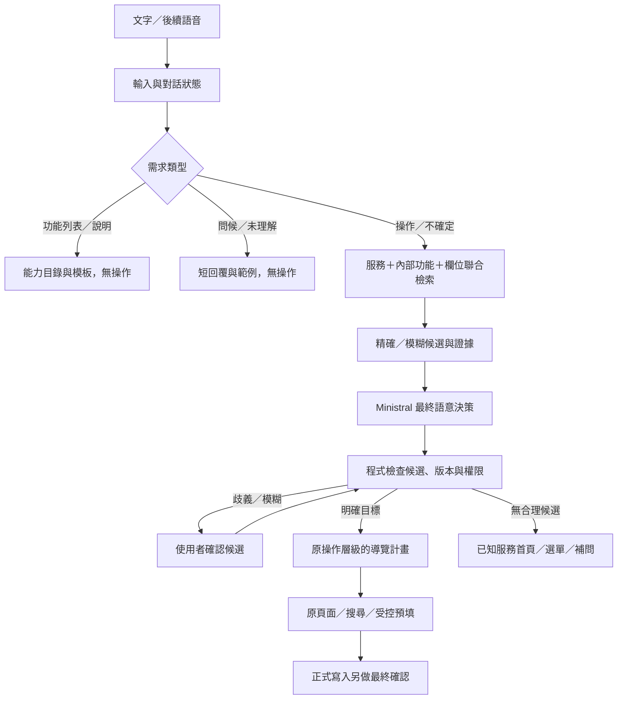

# TownPass 全功能助理分步實作計畫

日期：2026-11-05。狀態：已實作第一批共用能力與可用頁面導覽，裝置驗收待使用者執行。
沿用非中國開發的 `ministral-3:3b`、Flutter／GetX、原服務頁面與官方 WebView bridge。
實作須遵守 [AGENTS.md](../AGENTS.md)。現況見 [第一階段紀錄](AI_PHASE1_IMPLEMENTATION.md) 與
[功能查核](FEATURE_AVAILABILITY_20261104.md)；各服務上線前須重新驗證可用性。

本文件為全功能擴充的新規劃主檔。涉及一般對話、模糊確認與返回路徑時，以本文件取代
第一階段「直接 deep link」「多筆直接搜尋」「零精確匹配直接首頁」的簡化策略。
本次進度、限制及實際操作清單見 [全功能第一批實作紀錄](AI_EXPANSION_IMPLEMENTATION.md)。
後續階段仍依本計畫逐步導入，不代表全部服務已具備正式 API。

## 1. 目標與能力狀態

「所有功能加入」涵蓋主頁籤、原生功能、21 個服務入口、服務內部操作／欄位，及一般問題回覆。
每項先登錄目錄，再按已驗證能力啟用；不是一次向模型開放全部工具。

每項都要區分 App 資源狀態（原生實作／示範網頁／只有 UI 或空回呼／待驗證）、
助理能力（導覽／搜尋／詳情／預填／需確認寫入／未串接），及資料性質（正式／本機／示範）。
「有列入目錄」不等於「現在能操作」，導覽可先啟用，正式送出仍可停用。
缺頁面、API、認證或資料時明確說明，不造網址或假完成畫面。

## 2. 統一對話流程



明確問候、空白、功能列表、取消可由程式與模板處理，無須每次推論。
含「嗨」或「你可以」但同時提出具體需求時，要保留操作意圖，不被問候規則吃掉。
不確定意圖才交給模型；操作類仍由程式先縮小候選，模型站最終語意層。
一般回覆必須 `action=null`，不能觸發導覽、殘留的待執行工具或舊確認。

## 3. General 問題與無操作回覆

| 類型 | 回覆與動作 |
| --- | --- |
| 「你能做什麼／有哪些功能」 | 從助理已啟用能力產生分類列表，可點選合法入口；清楚標示示範功能 |
| 「App 有哪些功能」 | 列完整 App 目錄，另標助理未串接／不可用；不能把未完成項目列成現在可完成 |
| 「圖書裡能做什麼」 | 列服務內子功能與狀態，不只服務首頁 |
| 問候、感謝 | 短模板，例如「嗨，我是 TownPass 助手，可以幫你找服務、開啟頁面。你想做什麼？」 |
| 隨意字元、離題或無法理解 | 不操作；「我還不太確定你的需求，可以告訴我想使用的服務，或查看功能列表。」不指責使用者 |
| 空白／只有標點 | 輸入端提示，不送模型請求 |
| 「怎麼借書」等教學 | 用核對過的說明提供步驟，可附開啟按鈕；詢問教學不自動等於導航授權 |
| 「取消／不是這個／剛才說錯」 | 清除或更新待確認狀態，不執行舊操作 |

列表由同一份 Registry 產生，不讓模型憑記憶列功能。
先分類、再顯示子功能，提供「查看全部／下一頁」，不把全目錄塞進小模型提示。
回覆可用 `reply_template_id`／`show_capabilities(scope, category)`，實際文字與項目由程式產生。
模板只用於無操作回覆；真實執行失敗必須回錯誤與下一步，不能用問候掩蓋。

## 4. 服務、操作、欄位與導航目錄

建立版本化 `CapabilityRegistry`，逐步取代目前後端圖書專用的條件分支。

```text
Service：圖書借閱
  Operation：開總覽／搜尋／書籍詳情／借閱紀錄／預約清單／選取書館
    Field：書名／作者／ISBN／冊次／取書館／紀錄 ID
```

| 結構 | 必備內容 |
| --- | --- |
| Service | 穩定 ID、名稱、別名、外層關鍵字、狀態、資料性質、operation IDs |
| Operation | 意圖、內部關鍵字／片語、欄位、唯讀／寫入、前置條件、Adapter 版本 |
| Field | ID、型別、名稱／別名、實際選項與限制、原文證據、是否允許模糊匹配 |
| Entity provider | 真實書目／館別／分類／單位等資料與版本，只讀必要資料 |
| Navigation | 原頁面 ID、業務父頁、原操作路徑、Flutter／Web 類型、返回與關閉政策 |
| Copy | 說明、操作指引、不可用原因、一般回覆模板 |

同一能力在不同位置的入口要對齊；名稱相近但不同能力必須分開，
例如「用水服務」與帳務「水費」。從原始碼／設定取得資料並人工核對，不能由模型爬頁新增工具。

## 5. 服務與內部功能一起 filter

每組 `(service_id, operation_id)` 建立索引文件：
`服務名稱＋別名＋服務關鍵字＋內部功能名稱／片語＋欄位名稱／選項線索`。
內部功能的專有詞可以直接提名服務，不必先命中外層名稱。
同時命中服務詞與內部功能詞可以提高排序，僅內部詞命中也能提名候選。

| 線索 | 應提名的候選與處理 |
| --- | --- |
| 取書館、冊次、ISBN | 圖書服務及相關子功能，即使沒說「圖書借閱」 |
| 候號、櫃檯、現在幾號 | 臨櫃叫號／查看候號，不自動建立預約 |
| 案件進度、案件紀錄 | 申辦、陳情、警政、災情等；跨服務共用詞需要選擇確認 |
| 帳單、繳費紀錄 | 帳務子功能，不因「紀錄」也出現在圖書就誤配 |
| 取票、票夾、優惠券 | 票券／優惠，不與取書混淆 |

初期用加權詞彙、倒排索引、字元 n-gram 與編輯距離，無須另一個大型前置模型。
排序綜合服務詞、內部詞、欄位證據與上下文；「查詢／修改／紀錄」等通用詞權重低，
域內專有片語與組合較高。否定、修正、停用功能、多意圖與跨服務衝突獨立檢查。
先合併操作命中，再通常保留 1–3 個合理服務，服務內再縮到 1–3 個操作。
模糊度高時補問，不為減 token 強裁成一項。權重與門檻用保留集量測，不寫死未驗證分數。
模型只看縮小後的候選與證據，不看全量服務樹；分別量測各層召回、誤提名、候選數與 token。

## 6. 模糊匹配與確認：服務、內部功能及 input 都適用

匹配分成精確單一、精確多筆、模糊候選、無合理候選。
模糊分數高不等於使用者已選定，即使只有一個模糊候選也先確認。

| 層級 | 精確且唯一 | 模糊／多義 | 無合理候選 |
| --- | --- | --- | --- |
| 服務 | 明確要求導覽可直達 | 列服務候選，等使用者選 | 功能列表或補問用途，不強迫導圖書 |
| 內部操作 | 執行該服務允許的準備工作 | 列相關操作並確認 | 已知服務首頁或說明不支援，不假裝操作完成 |
| 書籍／館別／單位等實體 | 核實 ID 後開詳情 | 列名稱及辨識資訊，確認後才開／套用 | 已知服務首頁，保留手動搜尋，不開空結果 |
| 欄位選項 | 使用真實 enum／ID | 問「你指的是這個選項嗎？」 | 留空補問，不能捏造值 |

明確要求「搜尋／列出符合結果」可顯示原搜尋清單，這不是替使用者選一筆。
但將錯字或含糊詞改為另一個服務／書名／值時，必須先確認，不能偷偷替換搜尋詞。
例如「底層羅輯」未精確命中，但模糊找到「底層邏輯」，先提供候選確認，不直接跳書籍頁。
只有完全找不到合理候選，才沿用先前「圖書首頁」fallback；不是一精確比對失敗就放棄檢索。

欄位策略：

- 書名、分類、館別、行政區等受控名稱，可對實際資料做模糊檢索並確認。
- 描述等自由文字保留原文；可整理成待檢視草稿，不任意改造成其他內容。
- 電話、金額、日期、身分識別碼先做格式／範圍／檢查碼驗證，不能用編輯距離改數字、補區名或猜值。
- 精確抽取仍需欄位及跨欄位驗證；正式送出前顯示整份待送內容。

### 待確認狀態

`pending_resolution` 記錄 service/operation/entity/field 類型、原文、已確認服務、欄位 ID、
有限候選與真實 ID、資料版本、session／request、有效期限及解析版本。
提供候選卡片、「以上都不是／取消／改說需求」。
「第一個／就是它」只在同 session 有明確待確認集合時有效；多選項不能只用「好」決定哪一筆。
換題、返回／關閉取消、資料更新、過期及修改，均使舊確認失效；遲到回覆不能跳頁。
確認時重驗候選歸屬、ID 與版本，不接受任意網址或 client 自造 ID。

**候選確認不等於交易確認**：確認書名／館別只授權選值，預約、送件、付款仍需另一個明確確認。
多欄位可先一次呈現待確認差異，減少長者反覆回答；有歧義的欄位不能被整份草稿默認覆蓋。

## 7. 返回必須符合原本手動操作

目前直接打開詳情 URL 不保證有父頁歷史，新版需 NavigationPlan，不能只硬加返回首頁按鈕。

```text
助理直接定位：App 主畫面 → 原圖書總覽 → 書籍詳情
                                      返回 → 原圖書總覽

使用者從搜尋點入：原圖書總覽 → 原搜尋結果 → 書籍詳情
                                           返回 → 原搜尋結果（保留條件）
```

背景書目檢索不是使用者真的進過的頁面，不加入可見瀏覽歷史。
依 2026-11-05 使用者驗收調整：每次新的助理導覽先清除 App 主畫面之上的舊頁面，
再建立新服務自己的正常父頁；關閉整個服務回 App 主畫面，不保留前一輪服務歷史。
只有成功決定導覽目標時才清除；問候、候選確認、取消與無效目標不改目前頁面。

- Flutter／GetX：保留原 route、父頁、頁籤與進入前狀態，沿用原參數和 bindings。
- WebView／Vue Router：在同一服務 WebView 內建立已核對的父頁→目標頁，
  優先由自有 TownPass-Services Adapter 呼叫原 router，等 ready／資料初始化後進下一頁。
- 若已在合法父頁就重用，避免重複壓頁；不以每步新開 WebView、任意 DOM 點擊或未限制 JS 偽造歷史。
- NavigationPlan 至少有 entry/target page IDs、parent_chain、entity ID、entry_context、back_policy、
  資料／Adapter 版本及導航交易 ID。路徑由程式映射，模型不能拼 URL 或父頁序列。
- 受控 Adapter 保持原 `{name,data}` bridge 向後相容；無法可靠建立原返回路徑時先只開首頁，
  不能把 cold deep link 宣稱為正常上一頁行為。

返回優先序：關閉輸入／候選面板 → 原頁面離頁提示 → Web 服務歷史 → Flutter 父頁。
工具列返回、Android 返回及原網頁返回要一致；「關閉服務」與「上一頁」分開。
返回不得重送表單、重做交易、重跑模型、多退一頁或靜默丟掉草稿；沿用原服務未儲存提示。

## 8. 全功能導入清單

下面是待導入範圍，不代表已全部存在或可操作。每項必須有狀態、頁面／資料來源、
內部操作與欄位契約、返回契約、自動測試及使用者驗收項目。

### 原生與輔助功能

| 批次 | 功能 | 界線 |
| --- | --- | --- |
| N1 | 首頁／服務／優惠／帳務／帳號；活動列表／詳情、訊息列表／詳情 | 先導覽與唯讀，mock 標示 |
| N2 | 基本資料／編輯、App 起始頁、我的服務／置頂、手機載具 | 顯示與本機變更分開；只有 UI 先標未完成 |
| N3 | 語言、通知偏好、快速登入、歷程與授權、登出、停用帳號、意見回饋、市政新聞、帳務新增／設定 | 補空回呼、狀態與持久化，不只加 AI 包裝 |
| N4 | 功能教學、隱私說明、聯絡方式、QR 掃碼、定位／地圖、電話入口 | 先說明／導航，權限與實際撥號另外確認 |

### 21 項服務入口

| 服務 | 內部功能／欄位導入範圍 | 條件／批次 |
| --- | --- | --- |
| 1999 | 說明、電話／語音入口 | D：先處理入口不一致；不自動撥號 |
| 申辦服務 | 分類、申請表、必填欄位、案件進度 | W2：示範導覽先行，正式申請另接 API |
| 有話要說 | 類別、地點、標題、描述、查詢／詳情 | W2：草稿預填，正式送件另啟用 |
| 臨櫃叫號 | 單位、櫃檯、候號、常用單位、聯絡／地圖 | W2：先查看，取號／預約需實際契約 |
| 網路投票 | 主題、規則、選項、紀錄 | X：空入口，需頁面與資格契約 |
| 市政資訊儀表板 | 資料主題、圖表／頁面 | W3：重驗網域，不編造資料答案 |
| 意見調查 | 問卷、題目／選項、草稿 | X：空入口，需實際資源 |
| 警政服務 | 線上報案、類別、紀錄／詳情、電話說明 | W2：先修 route；正式報案與緊急電話不能一般自動提交 |
| 里辦服務 | 區／里、服務項目、聯絡資訊 | X：需頁面與資料 |
| 災情通報 | 類別、位置、描述、查詢 | W2：示範／草稿，正式通報另接 API |
| 疫苗預約 | 疫苗、資格、院所、日期／時段 | X：需真實預約資源，不猜名額 |
| 聯醫掛號 | 院區、科別、醫師、日期／時段 | X：需正式資源與認證 |
| 台北電台 | 節目、頻道、播放入口 | X：需核對來源與播放能力 |
| 親子館 | 館別、活動、日期、名額、草稿 | X：需報名資源 |
| 簡單森呼吸 | 綠化地點、地圖、篩選 | X：需地點／地圖資料 |
| 寵物安心遛 | 友善地點、地圖、篩選 | X：需實際資料 |
| 用水服務 | 用水查詢、自報度數、水費入口區分 | X：水費頁不代表其餘能力存在 |
| 民生物資 | 類別、期間、交易量／金額資料 | X：需資料來源，不以模型編統計 |
| 圖書借閱 | 總覽、書名／作者／ISBN 搜尋、書籍、排行榜、公告、借閱／預約紀錄、館別／冊次 | L：先完善模糊確認／返回，再逐項啟用子功能 |
| 找地點 | 類別、地點、鄰近資訊、地圖／路線 | W3：驗地圖金鑰、定位及資料源 |
| 愛遊動物園 | 園區資訊、地圖、地點查找 | X：需入口與資料 |

X 的內部項目是待核對／建置範圍，不是宣稱原專案已有這些操作。

### 其他服務與帳務子功能

| 批次 | 全部納入項目 | 界線 |
| --- | --- | --- |
| W1 | 優惠列表／搜尋／詳情、票券詳情、票夾／兌換入口 | 瀏覽與購買／核銷分開 |
| W1 | 訂閱總覽／項目／詳情／取消入口 | 先唯讀；新增／取消屬寫入且資料可能是 mock |
| W1 | 停車費、水費、地方稅、學雜費、國／社宅租金維管費、聯醫醫療費、平價住宅維護費、公訓處課程、其他繳費 | 每個 fee ID 與欄位分別驗證 |
| W1 | 繳費搜尋、帳單結果／詳情、帳務紀錄／詳情、掃描入口、支付步驟 | 導覽／預填不等於付款；正式支付另接 API 與確認 |

## 9. 分步實作與完成條件

| 步驟 | 交付 | 完成條件／依賴 |
| --- | --- | --- |
| P0 完整盤點 | N、21 服務、W 子功能目錄；頁面、欄位、父頁、來源版本 | 全清單有狀態，空入口不標可用 |
| P1 General | 功能分類／服務內列表、問候、未理解、教學模板、`action=null` | 無操作對話不導航；混合問候不吃掉請求 |
| P2 候選確認底座 | service-operation 聯合索引、實體／欄位模糊檢索、pending_resolution、多輪失效 | 未確認模糊值不套用；未知需求不全導圖書 |
| P3 正常返回 | NavigationPlan、GetX／Web Adapter、圖書父頁歷史、返回／關閉分離 | 直接書籍詳情返回總覽；從搜尋點入返回搜尋；新助理導覽取代舊服務歷史 |
| P4 圖書子功能 L | 已有圖書子頁、模糊書名／館別／冊次、紀錄、公告、排行榜與受控預填 | 每項有 Provider／返回／歧義測試；預約仍等使用者確認 |
| P5 N 與 W1 | N1→N2→N4；優惠、票夾、訂閱、帳務，按批導覽／唯讀 | 先 open/list/detail，再加支援欄位，不一次放開副作用 |
| P6 W2／W3 | 申辦、陳情、災情、警政、叫號，再地圖／儀表板；原表單預填與回讀 | 類別、單位、地點、欄位可候選確認；缺資料補問，不假成功 |
| P7 N3／X／D | 補空回呼／持久化，取得缺少的頁面、資料、API 與服務 Adapter | 逐項驗認證、資料、操作、返回；外部依賴未到就保留未啟用原因 |
| P8 正式業務 | 正式登入與政府／館藏／預約／支付 API、最終確認、冪等、查詢不明結果、稽核及部署 | 沙盒驗證後逐能力啟用，示範完成頁不能當正式交易成功 |

P1–P3 是其他服務的共同底座，先用圖書驗證，不讓每個服務複製一套 fuzzy 與導航。
P5／P6 小批次交付，不必等待全部 X 外部資源到齊；新增能力用 feature flag 與契約版本控制。
每個服務固定流程：原頁面／欄位盤點→目錄及內部詞→Provider／Adapter→候選確認→
返回路徑→導覽／預填→自動測試→使用者驗收→啟用。
估時依頁面、Adapter 及外部依賴另估，不把未取得的 API 當成已可控工期。
語音與朗讀在文字、確認與返回穩定後再加，不阻擋本次核心導入。

## 10. 程式與 API 契約

後端把 server.py 的專用分支逐步拆為小型 registry、retrieval、resolution、navigation 與服務 adapters，
保留共用驗證器，不先搭建無關大型框架。
Flutter 維持 controller／service／executor 的既有責任，新增候選面板，不重寫原服務 UI。

| 回覆 kind | 契約 |
| --- | --- |
| reply | 模板／功能列表，`action=null` |
| confirm_candidates | resolution ID、候選、服務／欄位上下文，未確認不導航／預填 |
| navigate | 已驗證 NavigationPlan、資料及 Adapter 版本 |
| prefill_review | 草稿、原值／建議值、原文證據、回讀與待確認差異 |
| unsupported／error | 明確說明、合法手動入口／重試，不沿用舊 action |

新增目錄查詢、候選確認／取消、導航結果／頁面 ready、草稿預覽與業務確認 API。
確認 API 檢查 session、候選／草稿版本、ID、期限與取消狀態；未知 kind 一律拒絕。
頁面與候選文字是不可信資料，不能擴充工具權限。
本機維持 adb reverse；正式多使用者需 TLS、完整認證、session 隔離及流量限制。

## 11. 驗收與避免過擬合

按「服務×操作×匹配型態×對話狀態×返回」建立測試矩陣，開發集／保留驗收集分開。
不因使用者一句新說法就新增該句專用正則或詞典；看整類召回與誤判，不只重跑已調參 40 句。

| 類別 | 必測 |
| --- | --- |
| 一般對話 | 清單狀態、問候不操作、未理解回覆、混合意圖 |
| 聯合檢索 | 只說內部功能仍召回、通用詞不亂配、否定／修正／多服務 |
| 模糊確認 | 多候選、單一模糊候選、無候選、以上都不是；未確認不執行 |
| 欄位 | enum 錯字、自由文字保留、數字不模糊改寫、條件必填 |
| 對話狀態 | 序號選擇、換題、過期、取消、遲到回覆、跨 session 不得互用 |
| 返回 | 冷開詳情回父頁、手動搜尋保留條件、重複導覽、關閉服務、系統與工具列一致 |
| 未完成資源 | 空入口、只有 UI、mock、權限／金鑰／登入／網路失敗均誠實回覆 |
| 業務寫入 | 選候選不等於送件、改草稿使舊確認失效、重試／超時不重複交易 |

分開報服務／操作／實體召回、確認後落點、錯誤自動操作數、補問／拒絕、返回層級、
token、p50/p95 與記憶體；固定回覆不需推論時另量測。
每批依 AGENTS 執行 unit、wire、widget、路由／Adapter 及 Android 建置。
實際操作由使用者負責，交付輸入／預期頁面／返回結果的驗收表，不代操作或代勾通過。

## 12. 下一批建議

先做 **P0＋P1：完整目錄與 General 對話**，保留既有圖書工具可用；
再做 **P2＋P3：模糊確認與圖書正常返回**，最後分批擴充所有服務及內部功能。
