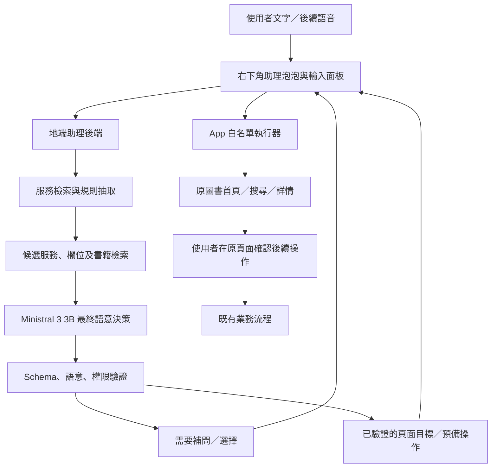

# TownPass 地端 AI Tool Calling 實作計畫書

初版：2026-11-04；本次修訂：2026-11-05。
後續全功能擴充以 [全功能分步計畫](AI_ALL_FEATURES_ROLLOUT_PLAN.md) 為準：包含 General 回覆、
服務與內部功能聯合檢索、模糊候選確認，以及符合原操作層級的返回路徑。
下文保留第一階段設計；新增規劃不代表已部署到目前 App。

狀態：第一階段實作與驗收。依使用者要求改採非中國開發的 **Mistral AI Ministral 3 3B**；
Qwen 的舊測試僅屬歷史，不作為現行執行設定。實際啟動與驗證狀態見
[實作紀錄](AI_PHASE1_IMPLEMENTATION.md) 與 [後端操作指南](../assistant_backend/README.md)。

適用專案：本 fork 的 TownPass Flutter App。程式查核基線為
`e4fbd3cef9c9a0a7926e03ec6f7bbd072f5f5045`；官方同步基線見
[開發指南](DEVELOPMENT.md)。實作前須閱讀 [AGENTS.md](../AGENTS.md)。
這是團隊提出的擴充方案，不是官方發布或認證的 AI 架構。

## 1. 目標與第一版範圍

讓不熟悉數位服務的人，從右下角助理泡泡輸入需求，由程式先縮小候選，再交給模型做最終語意決策。
工具重用既有頁面、搜尋、資料與表單能力，將使用者帶到可繼續操作的位置，並簡短提示下一步。

本次確認的互動契約：

| 使用者意圖 | 系統行為 | 停止位置 |
| --- | --- | --- |
| 只有服務名稱或泛稱，例如「我要借書」 | 開啟原圖書借閱首頁，不要求先補齊書名 | 使用者可自行搜尋 |
| 指定書名，例如「想借《底層邏輯》」 | 唯一明確匹配進原詳情；多筆顯示搜尋結果；沒有匹配則開原圖書首頁 | 指示下一步，尚未替使用者借書 |
| 明確要求預備操作，例如「幫我填這張表」 | 導覽並預填已支援、可撤回的欄位，回讀驗證 | 停在確認／送出之前 |
| 涉及正式預約、送件、付款或不可逆修改 | 保留既有業務頁面的確認與權限流程 | 使用者確認之前不得提交 |

「先完成該動作再等確認」在本計畫指完成搜尋、選定目標或預填等準備工作，
不能解讀為先發生交易／預約再補確認。第一階段完全不由 AI 送出借閱或預約。

第一階段以「泡泡文字輸入 → 圖書首頁／搜尋／詳情 → 下一步指引」形成完整流程，
不先同時擴充 5–10 種服務。詳細步驟與圖書測試案例見
[第一階段實作工作清單](AI_LIBRARY_IMPLEMENTATION_STEPS.md)。
其他服務沿用相同能力契約逐項擴充；現況見 [現有功能查核](FEATURE_AVAILABILITY_20261104.md)。
每個入口依能力目錄標示正式／示範／待驗證／未實作，不能把畫面存在當成業務完成。
語音、跨服務表單預填與正式 API 串接放在圖書階段驗收後。

## 2. 部署與責任分工



| 元件 | 建議配置與職責 |
| --- | --- |
| 手機 | Flutter UI、顯示確認、執行本機導覽與裝置授權，無須載入 LLM |
| 電腦／地端主機 | 助理後端、能力目錄、草稿與工作階段狀態、Ollama；之後加入語音辨識 |
| 候選／欄位程式 | 正規化、服務檢索、規則抽取、既有資料搜尋，組出最小但足夠的決策輸入 |
| LLM | 僅在最終語意層選擇候選服務與操作、核對欄位意圖，或決定補問／不支援；不承擔全量檢索 |
| 程式驗證器 | 決定提案是否允許執行；模型不持有業務憑證或任意執行權 |
| 業務 Adapter | 對應特定服務 API／受控網頁能力；沒有 Adapter 就不能宣稱已提交 |

後端第一版採獨立 `assistant_backend/` Python 標準函式庫服務，與 App 分開啟動；
用明確工具 schema、enum 與白名單檢查契約，暫不引入 FastAPI／Pydantic。
這是本機開發取捨，不是正式多使用者服務；後續正式部署再補完整服務框架與認證。
不將後端或 Vue 專案放入 Flutter `lib/`。網頁服務需要修改時，使用獨立 TownPass-Services fork。

Ollama 維持監聽電腦 loopback，由後端呼叫 `http://127.0.0.1:11434`。
手機只連助理後端；實機使用電腦區網位址，Android 官方模擬器可用 `10.0.2.2` 存取宿主。
後端測試連線需限定可信網段／防火牆來源、工作階段與配對憑證；離開單機測試時使用 HTTPS。
正式會員身分由正式登入系統驗證，不能把配對憑證當成會員授權。
Android HTTP 開發連線若受阻，僅做 debug 範圍配置，不放寬全域 release 網路政策。

## 3. 模型與效能初始設定

- 模型固定使用 `ministral-3:3b`，Mistral AI 開發；本機約 2.95 GB、Q4_K_M。
- 2026-11-05 查到模型 digest：
  `f04aa1c738f64e13c625b82ae92504fc0260fa6723b509ed1ece0fa188179b1d`。
  模型切換需重跑工具與中文案例，不可自動退回 Qwen 或雲端。
- Ministral 空參數原生 tool call 在本機測試不穩定，故採 Ollama JSON Schema 約束 `{name, arguments}`，
  再使用相同工具白名單驗證器；模型不產生可直接執行的 URL／JS。
- 依先前硬體盤點，RTX 4060 Laptop 8 GB、約 32 GB RAM 可作為初始測試主機；尚無完整本機效能基準。
  本次 `/api/ps` 回報模型 size 與 size_vram 均約 3.14 GB、context 4096；這不是整台電腦的峰值 VRAM 數據。
- 初始上下文 4K，必要時試 8K；通常縮至 1–3 個服務及 1–3 個可用操作，允許模型選擇補問／不支援。
  模糊請求可以保留較多候選或先補問，不硬裁成一項。
- 初始同時處理 1 個模型請求，忙碌時提示重試；短輸出、低溫度，使用指令型模型而非推理型變體。
- Ollama 實際版本、模型 digest、模板、thinking 參數與 tool parser 均須記錄並做契約測試，不假定不同後端參數通用。
- 模型下載／安裝失敗不阻礙目錄、驗證器及 UI 開發：可用明確標示的測試輸出，但不可當成模型驗收。
- 模型不可用時，保留傳統操作與規則式服務選單，呈現重試／取消；不偷偷改用雲端模型。

## 4. 服務與欄位目錄

建立版本化 `ServiceCatalog`，從現有 `MyServiceItemId`、路由及實際能力人工審核產生。
不直接讓模型讀取整個專案或任意掃描網頁後新增工具。

每項服務至少包含：

| 欄位 | 用途 |
| --- | --- |
| `service_id`、`display_name` | 穩定識別碼與使用者可讀名稱 |
| `aliases`、`keywords`、`negative_patterns` | 正式名稱、口語、特定業務詞及排除線索 |
| `intents` | 開啟、查詢、填草稿、修改、取消等不同意圖 |
| `availability`、`data_mode` | 可導覽／待驗證／未實作；正式／示範／本機狀態 |
| `capabilities` | open、search、detail、prefill、commit 分別啟用，圖書第一階段只開前三者 |
| `destination` | 由程式維護的頁籤／route／受控網址映射，不交給模型編造 |
| `fields` | 欄位 ID、名稱、別名、型別、選項 ID、限制、解析器、必填與條件規則 |
| `required_adapter_version` | 執行端支援的能力版本，避免後端比手機更新時誤呼叫 |
| `verification` | 查核日期、程式來源、HTTP／畫面／完整流程驗證結果 |

例：圖書搜尋欄位可對應官方示範原始碼已有的
`all`、`book_name`、`author`、`publisher`、`subject`、`isbn`；
陳情測試草稿先對應 `location`、`title`、`description`。
陳情分類 ID 需由實際服務資料取得，不能猜測；現有表單沒有獨立「區」欄位時，
不得把自行抽出的區名假裝是官方 API 欄位。

## 5. 先篩選、後由模型做最終決策

目標是「保留正確候選的前提下盡量少」，不是為了 token 數把正確答案排掉。
不以第二個大型模型做前置判斷；第一階段也不需要向量資料庫。

1. **可用性與版本過濾**：依已驗證能力、App／Adapter 版本與當前支援範圍建立工具白名單。
   未實作服務仍保留名稱及停用原因供識別，不能把「掛號」錯導到唯一已開放的圖書服務。
2. **正規化與保護詞**：處理全半形、空白與受控同義詞；保留原文、否定、修正、書名、ISBN 與多意圖。
   不把「不要借書」清洗成「借書」，也不任意簡繁轉換書名中的專有文字。
3. **便宜的服務檢索**：以名稱、別名、特定詞、欄位線索、目前頁面與明確對話指涉加權。
   先用可解釋加權詞彙／倒排檢索；服務增加後才評估 BM25 或小型 embedding 是否必要。
4. **縮小但保留歧義**：明確請求通常只剩 1 個服務；模糊時留 2–3 個並比較分數間距。
   無命中時先做受控同義詞擴展；仍無可支持候選則補問。取消、閒聊、不支援永遠可選。
   權重、門檻與 top-k 必須由驗收集調整，不在文件裡把未測門檻當成可靠值。
5. **在少量候選內抽欄位**：使用欄位名稱、別名、enum 與明確格式；
   例如《書名》、ISBN、作者詞，以及「電話／門牌／數量＋值」。每個值帶原文證據與來源。
   規則無法可靠解析的殘餘片段保留給最終模型；不先硬填錯誤值。
6. **實體檢索**：已有書名／ISBN 時，用與頁面一致的書目資料查詢，產生少量書籍候選與真實 ID。
   優先精確 ISBN／正規化書名，再部分字詞配對；模糊相似不能當作唯一確定目標。
7. **一次最終模型決策**：輸入原文、必要上下文、規則證據、候選服務／動作、少量書籍候選。
   模型只選開首頁、搜尋、開候選詳情、補問、取消或不支援；可以否定前置候選，不得編造新服務／ID。
8. **程式驗證與編譯執行**：校驗 schema、原文支援、候選歸屬及資料版本，
   將語意決策編成有限的導覽步驟，再重用原頁面。失敗回到選擇／手動操作。

若最終模型補出前置規則漏掉的書名，先回傳搜尋操作；執行器查資料後，只有唯一明確相符才進詳情，
多筆匹配停在搜尋結果，沒有匹配回圖書首頁；原文殘餘片段不可直接變成空結果查詢。
不為了這個分支建立無上限模型迴圈。
每輪最多一次正常模型決策；解析錯誤最多一次修正，仍失敗則走人工選項。

前置檢索驗收須另外量測 candidate recall、平均／p95 候選數與提示 token；
若召回率下降，即使延遲變快也不接受。模型自報 confidence 不作為執行依據。
「不是 12 號，是 21 號」保留修正；缺欄位是否補問取決於該動作是否需要，
沒有書名不妨礙開圖書首頁。不能假設使用者的所有需求都是提交型任務。

## 6. Tool Calling 契約

模型只提議工具。目前因本機 Ministral 原生空參數工具呼叫不穩定，
使用 Ollama `/api/chat` 的 JSON Schema structured output，輸出 `{name, arguments}` 的工具提案。
與原生 `tool_calls` 共用候選工具驗證器，不將「JSON 能解析」當成語意正確。
第一版每輪最多接受 1 個語意工具提案；工具內的搜尋、定位與導航由固定程式流程完成。
禁止無上限 agent loop，模型不逐顆按鈕推理。

| 工具／操作 | 輸入與限制 | 執行位置／第一版狀態 |
| --- | --- | --- |
| `open_service` | `service_id` 必須在本輪候選與可用白名單 | 第一階段先允許圖書首頁 |
| `locate_library_book` | 原文支持的 `query`、搜尋 `type`；明確要求查看／借書的目的 | 第一階段，重用原搜尋／詳情頁；不預約 |
| `open_library_book` | 本輪書籍候選中經核實的 `book_id`，與明確書名／使用者選擇相符 | 第一階段，開原詳情頁並提示下一步 |
| `prefill_service_form` | 僅允許 Adapter 宣告的欄位與可撤回值 | 後續階段，回讀後等使用者確認 |
| `request_clarification` | 精簡問題、有限選項，不帶可執行動作 | 顯示補問 |
| `submit_report` | `draft_id`、版本、有效確認紀錄、冪等 key | 正式 Adapter 完成前停用，不提供給模型 |

`open_service` 原生工具定義示意（enum 由伺服器依本輪候選動態產生）：

```json
{
  "type": "function",
  "function": {
    "name": "open_service",
    "description": "開啟已驗證的服務入口；不代表完成申辦、付款或送出案件。",
    "parameters": {
      "type": "object",
      "properties": {
        "service_id": {"type": "string", "enum": ["library"]}
      },
      "required": ["service_id"],
      "additionalProperties": false
    }
  }
}
```

上述工具名稱及服務 ID 是本計畫的新契約，不是既有 TownPass bridge handler。
正式版本需對其他工具也提供完整 schema，並驗證模型不能加入 URL、Dart route、程式碼或額外參數。
第一階段後端以 `open_library` 對應 `open_service(library)`，
App 收到的是版本化 home/search/detail 目標，不會修改既有官方 bridge 名稱。

助理 API 建議：

| API | 功能 |
| --- | --- |
| `POST /v1/assistant/turns` | 傳文字、session、已知 App 能力版本，回補問、草稿或經驗證的導覽提案 |
| `POST /v1/assistant/actions/{id}/result` | App 回報成功、失敗、取消；模型不能自行宣稱執行成功 |
| `POST /v1/assistant/drafts/{id}/confirm` | UI 確認特定版本草稿，產生伺服器端確認紀錄 |
| `POST /v1/assistant/drafts/{id}/execute` | 僅在該 Adapter 已啟用時執行，由程式檢查確認及權限 |
| `GET /v1/assistant/capabilities` | 提供當前可用功能及示範標記 |

每次交換帶 `request_id`、`session_id`、契約版本；帳號身分由驗證過的工作階段決定，不信任任意 client user ID。
App 收到導覽提案後再次檢查白名單和本機能力版本，不直接執行模型原始輸出。
HTTP 200／路由推入只證明該階段成功；WebView 須回報載入失敗，業務成功須由 Adapter 結果證明。

## 7. 狀態、確認與失敗處理

第一階段流程：`received → filtering → deciding → clarify/ready → navigating → page_ready/failed/cancelled`。
搜尋與詳情定位可在 navigating 中按固定流程執行；`page_ready` 只代表已到頁面，不代表借閱成功。
預填階段擴充 `page_ready → prefilling → awaiting_confirmation`；
正式寫入僅在授權及確認通過後進 `committing → succeeded/failed/unknown`。

- 草稿綁定使用者／session、服務、版本及內容雜湊；內容修改後原確認失效。
- 使用者在原服務頁面看得到搜尋／預填結果、目的地、示範標記與下一步；
  一般導覽無須再加一層多餘確認。可能寫入的動作則必須在寫入前確認，不把模型文字當成確認。
- 語音輸入可先辨識「確認」意圖，但涉及提交時仍走應用程式可驗證的確認流程。
- 執行以伺服器確認紀錄及 Adapter 權限為準；模型不能產生可通過驗證的確認 token。
- 重複按鈕、重送與網路重試使用相同冪等 key；超時結果不明時先查詢，禁止盲目再送。
- 模型超時、非法 JSON、未知工具或不支援參數：最多有限次修正／重試，仍失敗則回到選單與人工操作。
- 網頁文字、模型回覆和工具資料均為不可信輸入，不能更新 system 指令或註冊新工具。
- 最小化傳送個資，日誌遮罩；原始語音預設不保存，測試資料使用合成內容。訂定草稿／session 到期清除規則。
- 撥號、付款、報案、位置與相機屬不同權限，不因已允許聊天而自動取得。

## 8. 與官方 Flutter／WebView 架構相容

建議新增位置，實作時按實際需要拆分：

```text
lib/page/assistant/widget/assistant_host.dart # 跨路由泡泡與面板
lib/page/assistant/widget/assistant_panel.dart
lib/page/assistant/assistant_view_controller.dart
lib/page/assistant/model/                 # 畫面狀態
lib/service/assistant_service.dart       # 助理 API
lib/service/assistant_action_executor.dart # App 白名單動作
lib/bean/assistant_*.dart                # API DTO
```

沿用 GetX、TP 元件、TPRoute 與 bindings，不換架構，不修改官方工具鏈來配合模型。
主頁籤透過 `MainViewController.currentIndex` 切換；不能直接導航到未註冊的 `/service`、`/home`。
其他原生頁面使用已註冊 route；服務網頁使用既有 `TPRoute.openUri`／`WebViewArgument`。
現有 `local://online_police` 與 `/online_police` 不一致，需獨立修正和測試後才列入可用入口。

泡泡使用 App 根層 `GetMaterialApp.builder` 的輕量 host，保留原本 route child，
沿用既有 controller 生命週期與 TP 樣式；避免只掛在 MainView，進 WebView 後就消失。
預設右下角，收合時不攔截其他區域觸控，展開為可關閉輸入面板；導航後收合並保留一段指引。
位置避開 SafeArea、鍵盤、底部導覽及圖書頁固定預約按鈕；必要時允許移位／暫時隱藏。
掃碼、系統權限或敏感確認情境可由 route policy 隱藏；測試 Android WebView 的疊層、返回鍵、焦點與螢幕閱讀器。

圖書優先沿用已存在的 URL 契約：

- 首頁：`/library-service/`。
- 搜尋：`/library-service/keyword-search?search=<encoded>&type=book_name`，原頁 onMounted 會讀 query 並搜尋。
- 詳情：`/library-service/book-detail/:id`，ID 必須來自同一資料來源。

URL 由程式的 Uri／queryParameters 建立及編碼，不拼接未轉義使用者文字。
`library.ts` 已自行匯入圖書 mock，和某些陳情頁需前頁初始化的情況不同；
仍需測「冷開直接到圖書詳情」及查無 ID 的畫面行為。
2026-11-05 已唯讀取得線上 `/mock/library/library_book_list.json`，6 本書目與查核 commit 的 JSON 相同；
頁面渲染與互動尚未驗收，後續仍需防止部署更新造成資料版本不一致。
若現有線上頁面與查核原始碼一致，第一階段可不新增填表 bridge；
如部署不一致或需要預填取書館，才在自有服務 fork 加受控、版本化 Adapter。
不能因使用者要某本書，就在 Flutter 另外重做一套借閱畫面。

現有 `flutterObject.postMessage(JSON.stringify({name,data}))` 保持不變。
現有 handler 沒有通用「讀表單／填表單／提交」能力；不能直接以聊天結果控制所有網頁。
需要預填時，於自行維護的服務網頁新增版本化 Adapter，設計 ready、套用草稿、回讀草稿及取消的明確握手。
檢查可信 origin、主框架、schema、能力版本；未就緒不可下發操作。
動態 deep link 必須能自行初始化 Pinia 資料，不依賴先進上一頁；目前部分示範頁有這項依賴。
不可對任意網頁注入通用填表／點擊 JS，也不可把手機帳號 token 直接放入模型提示。

## 9. 語音與無障礙

文字版驗收後，在地端主機增加 whisper.cpp 或其他經評測的辨識服務，先用按住說話、說完送出。
辨識結果先顯示並允許修改；日期、地址、電話和選項可逐項確認，不能只播放「已完成」。
測試臺灣華語、口音、噪音、慢速語音；台語與混語能力需實測，不保證 Whisper 可用。
語音辨識和 LLM 共用 GPU 時測峰值占用與延遲，可先序列執行或讓辨識走 CPU。
畫面提供大按鈕、清楚焦點與 Semantics、文字縮放、螢幕閱讀器、取消和傳統選單。
朗讀使用者可控制開關，避免在公共場所自動念出完整個資。

## 10. 分階段交付與驗收

| 階段 | 交付 | 通過條件 |
| --- | --- | --- |
| A：圖書契約與模型準備 | 來源一致的書目、候選規則、工具 schema、冒煙測試與語料 | 不支援服務不被錯導；已確認本機 API，仍需完整測試 |
| B：圖書完整第一階段 | 全域泡泡、後端最終決策、原圖書首頁／搜尋／詳情、指引 | 泛稱開首頁；指定書名到正確位置；歧義、無結果、取消與離線有處理；不自動預約 |
| C：其他服務及預填 | 依同一契約擴充服務、受控預填與原頁面確認 | 欄位回讀一致，取消不執行，清楚區分示範與正式 |
| D：語音與易用性 | 地端 STT、可編輯逐字稿、朗讀、目標使用者測試 | 實際完成率與理解度可量測，不只技術展示 |
| E：正式業務 | 正式認證、API、查詢、提交與稽核 | 沙盒驗收、冪等與不明結果處理完成後才啟用 |

圖書階段先建 40–60 句，後續擴至 150–300 句跨服務語料，預留不參與調參的驗收集；包含別名、數字＋key、否定、修正、兩個服務、
缺欄位、模糊地點、非服務問題、提示注入與尚未實作功能。語音加入辨識錯字案例。

初始驗收目標（是目標，尚非測得結果）：

- 第一階段先建立圖書與干擾服務語料，核心驗收案例見工作清單；之後才擴至 150–300 句跨服務資料。
- 候選服務／書籍召回率目標至少 99%，另報資料筆數與未命中原因；不是把模型決策正確率當成檢索召回率。
- 可處理的單一服務導覽意圖正確率至少 95%；另報需補問與不支援案例的正確處理率。
- 分開檢查首頁／搜尋結果／唯一書籍詳情的落點正確率、指引正確性及傳統操作是否仍可完成。
- 已抽取必要欄位的值正確率至少 95%，同時報抽取覆蓋率／整份草稿完全正確率，不能靠全部補問取得高分。
- 未知工具／越權／未確認提交／已停用服務：驗收集 0 次錯誤執行；不等於對所有未來輸入的保證。
- 暖機文字決策延遲先以 p50 ≤ 2 秒、p95 ≤ 5 秒為目標；量測實際值後調整範圍與設定。
- 分開報模型冷啟動、檢索、推論、網頁載入、語音辨識耗時、峰值 RAM／VRAM、佇列等待。
- 對已有傳統操作做回歸，確認手動導覽與既有 bridge 相容。

依 AGENTS.md 執行相關 unit／widget／整合測試、分析及 Android 建置。
模型決策驗收和 App 建置驗收分開報告；純文件階段無須重新建置 APK。

## 11. 開工順序與待確認事項

優先順序：圖書路徑與資料驗證 → 候選／schema／測試案例 → 後端及本機模型契約測試 →
全域泡泡與 App 執行器 → 圖書端到端驗收 → 其他服務／預填 → 語音。
第一階段程式已依此計畫新增，實際完成項目與尚未驗證部分以實作紀錄為準。
以 [第一階段工作清單](AI_LIBRARY_IMPLEMENTATION_STEPS.md) 作為後續實作順序與驗收依據。

正式實作前需確認：主機是否固定開機／位址、預期並行使用人數、是否維護自己的 TownPass-Services fork、
正式登入與 API 提供方式、地端資料保存政策，以及可參與測試的目標使用者。
估時須在模型與第一個 Adapter 驗證後提出，不把外部授權等待當成已可控工期。

## 12. 參考資料

- [Ministral 3 3B 官方模型卡](https://huggingface.co/mistralai/Ministral-3-3B-Instruct-2512)
- [Ollama 模型版本](https://ollama.com/library/ministral-3:3b)
- [Ollama Tool calling](https://docs.ollama.com/capabilities/tool-calling)
- [Ollama Structured outputs](https://docs.ollama.com/capabilities/structured-outputs)
- [whisper.cpp](https://github.com/ggml-org/whisper.cpp)
- [官方 TownPass](https://github.com/taipei-doit/TownPass)
- [官方服務範例](https://github.com/taipei-doit/TownPass-Services)

上述模型與執行框架能力於文件撰寫時核對；實作時仍應記錄實際版本與本機驗收結果。
