<p align="center">
  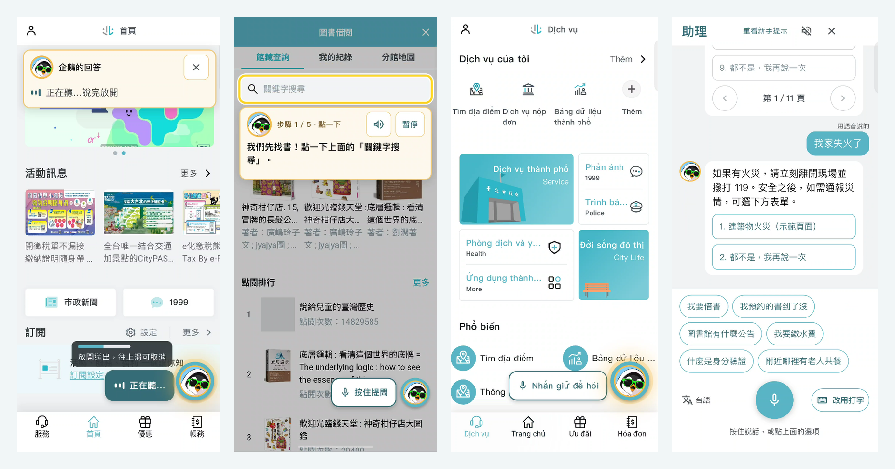
</p>

# 台北一點就通！微服務入口整合助理 / TownPass On-Device Service Assistant

【2026臺北秋季程式設計節-城市通微服務大黑客松】第一名得獎團隊：尖銳吉吉如綠豆冰

> 助理是台北通（TownPass）App 裡的一個**微服務**：依附台北通執行，透過台北通的頁面、路由與 WebView，帶使用者找到並用好其他微服務。
> 程式整包放在 `portal_assistant/` 資料夾（Flutter 套件、手機上執行的 Python 後端、原生模型伺服器與文件）；台北通只要照
> **[串接文件 INTEGRATION.md](INTEGRATION.md)** 改幾個檔（每處只有幾行，程式碼在 [integration/](integration/)）。
> 本 repository 的根目錄就是一份已經接好的台北通 App（官方 [taipei-doit/TownPass](https://github.com/taipei-doit/TownPass) 的 fork），可以直接建置執行。

**English summary.** An AI assistant for the TownPass (台北通) app that runs entirely on the phone: no cloud model, and
recordings never leave the device. Speak Mandarin, Taiwanese Hokkien, English, Japanese, Vietnamese, Indonesian or
Filipino (or type), and it opens the right TownPass service page; on forms it teaches step by step on the real service
page (task cards, highlight halos, fill fields and pick options by voice, skip optional fields), and the whole app and
the service pages follow the user's language. It is a microservice of the TownPass app: its code is packaged in one folder that plugs into TownPass
through a small host interface and 24 short hooks documented in [INTEGRATION.md](INTEGRATION.md).

## 目錄

- [一、一般參賽者必填項目](#一一般參賽者必填項目readme)
  - [1. 專案簡介](#1-專案簡介--project-overview)
  - [2. 系統架構](#2-系統架構--system-architecture)
  - [3. 安裝與執行方式](#3-安裝與執行方式--installation--run)
  - [4. 功能說明](#4-功能說明--features)
  - [5. 用 agent skill 擴充](#5-用-agent-skill-擴充--extension)
- [二、AI 使用聲明](#二若使用-ai需額外補充的項目ai-usage-declaration)
- [三、串接到台北通](#三串接到台北通)
- [四、專案結構與文件](#四專案結構與文件)
- [授權與致謝](#授權與致謝)

---

# 一、一般參賽者必填項目（README）

## 1. 專案簡介 / Project Overview

### 專案目的與想解決的問題

台北通有很多好用的服務，但很多人不是找不到服務，而是找不到**選單**：

- **長輩**：不習慣看字、不知道「繳費」在哪一層、不習慣打字；有些人聽得懂華語、也看得懂中文字，卻只會講台語。
- **移工、新住民、旅客**：介面和服務名稱都是中文；就算會一點中文，也不知道「規費」「陳情」是什麼。
- **第一次用的人、數位使用能力較低的人**：台北通的微服務很多，想借書，卻根本不知道要從哪裡找到借書的頁面；
  進去之後也不知道要選哪些東西（先搜尋、選分館、再預約），表單上哪幾格一定要填也不清楚。

我們的目標是讓使用者**用講的**就能用到台北通的微服務：說一句話，助理打開對的服務頁面；
需要填表時，在**真正的服務頁面**上一步步教，欄位與選項都能用說的填，頁面也翻成使用者講的語言。同時堅持三個原則：

- **離線**：語音辨識、決策、檢索、頁面翻譯都在手機上執行，沒有雲端模型。
- **隱私**：錄音不存檔、不上傳；填欄位時講的內容不進對話紀錄、不送決策模型。
- **不越權**：助理不替使用者送出、付款、撥號、預約或勾同意聲明；最後一步一律由使用者自己按。

### 核心功能摘要

按住說一句話（中文、台語、英、日、越、印尼、菲律賓文），助理在手機上聽懂並直接打開對的台北通服務頁面；
需要操作時用企鵝任務卡和光圈在真實頁面上一步步教，欄位用「按住輸入」、選項與地址用「按住選擇」說的就能填，
整個 App 畫面與服務網頁跟著語言翻譯。

### Demo Screenshot

| 按住提問 | 引導教學（圖書借閱） | 非必填欄位：跳過這格 | 台語緊急回應 | 越南文整頁翻譯 |
| --- | --- | --- | --- | --- |
| 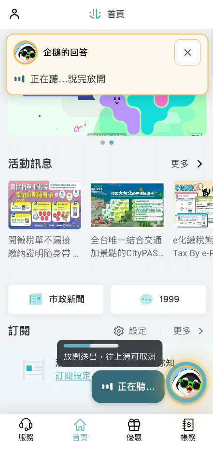 | 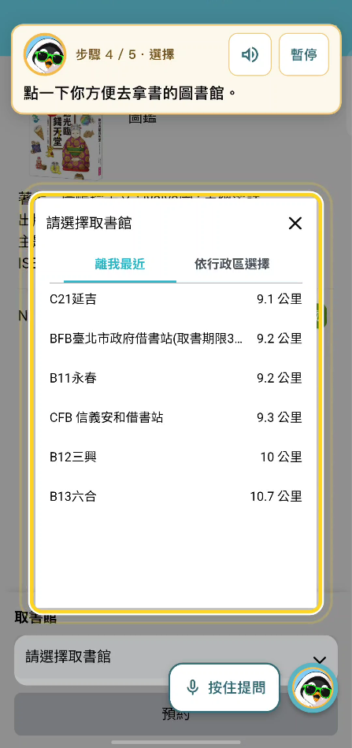 | 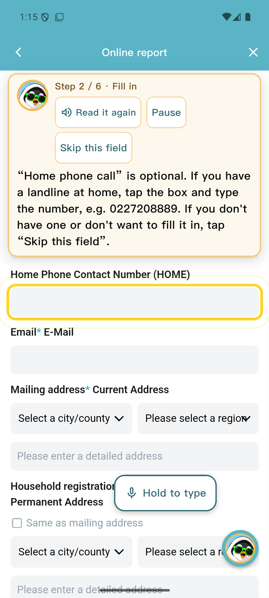 | 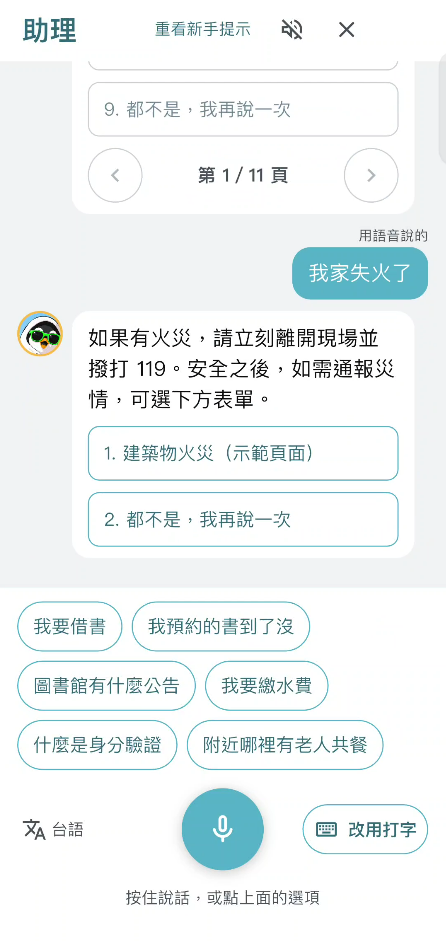 | 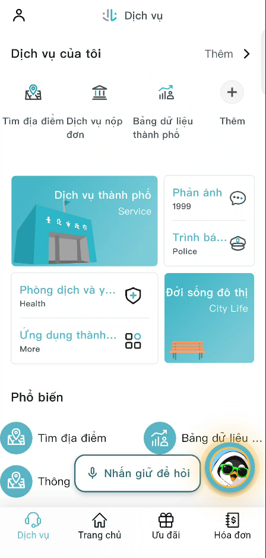 |

<details>
<summary>圖書借閱完整 5 步驟（7 張截圖）</summary>
<table>
  <tr>
    <td width="25%">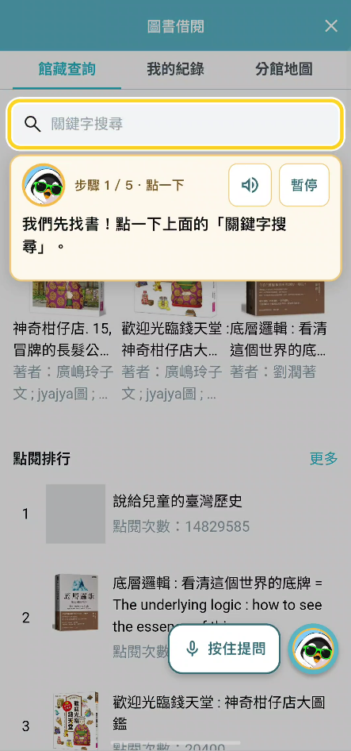<br><sub>1. 點一下搜尋</sub></td>
    <td width="25%">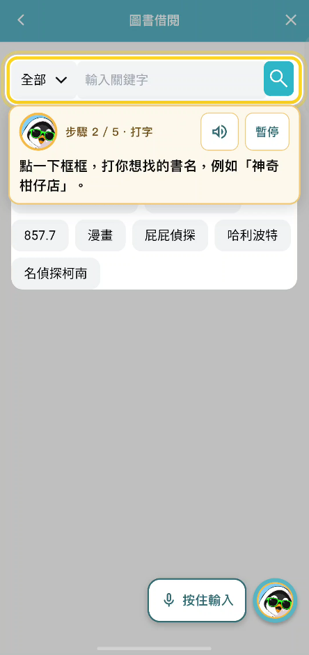<br><sub>2. 打書名（或按住輸入）</sub></td>
    <td width="25%">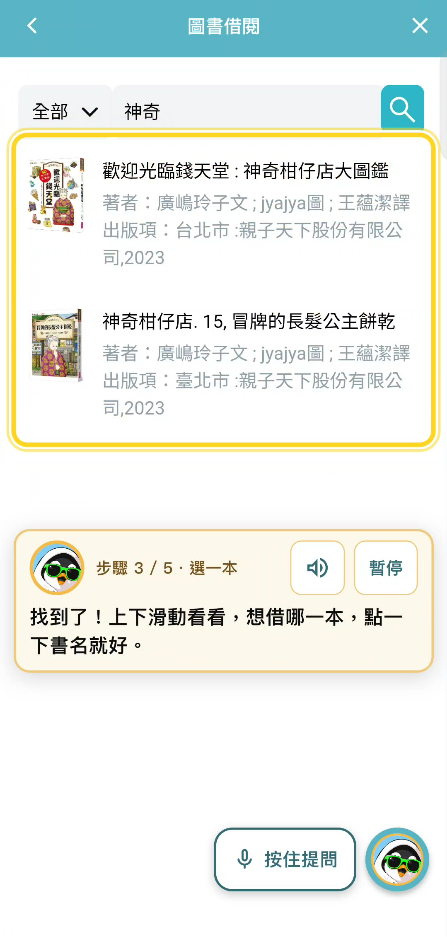<br><sub>3. 選一本</sub></td>
    <td width="25%">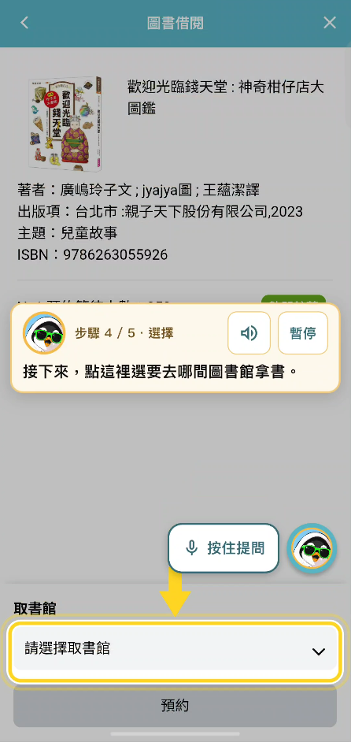<br><sub>4a. 找到取書館欄位</sub></td>
  </tr>
  <tr>
    <td><br><sub>4b. 選分館</sub></td>
    <td>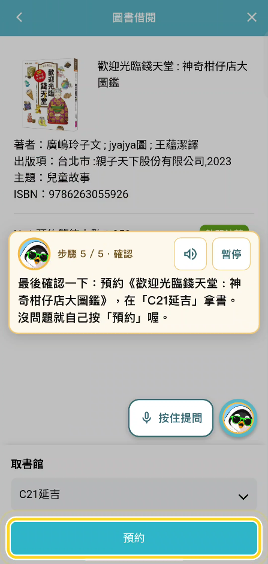<br><sub>5. 自己按「預約」</sub></td>
    <td>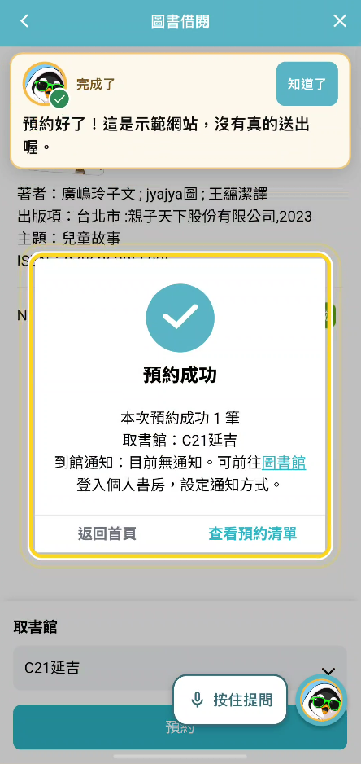<br><sub>完成</sub></td>
    <td></td>
  </tr>
</table>
</details>

## 2. 系統架構 / System Architecture

### 架構圖

手機（Android 或 iPhone）上有台北通 App（內含助理套件）、一個 Python 後端與數個本機模型伺服器，全部只綁在 `127.0.0.1`；
App 只連後端 `:8765`。網路只用來讀取服務網頁與資料、第一次下載翻譯檔，以及使用者同意後下載模型。

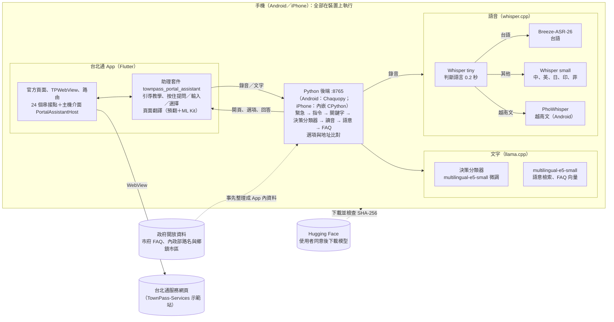

一句話的旅程：按住說話 → Whisper tiny 判斷語言（0.2 秒）→ 依語言交給一個模型聽成文字（台語給 Breeze-ASR-26、Android 上的越南文給 PhoWhisper、其他給 Whisper small；
中文結果讀起來不像華語或 App 認不得時，再讓 Breeze 聽一次，留比較合理的那份）→ 後端規則優先、分類器只替候選頁打分 →
開頁、列出 2–4 個選項或回答。只有一個明確選項、而且分數夠高才直接開；其他情況列出來讓使用者選，不亂開。
更細的流程見 [docs/AI_TECHNICAL_OVERVIEW.md](docs/AI_TECHNICAL_OVERVIEW.md)，行為規則的唯一準則是 [docs/AI_CURRENT_RULES.md](docs/AI_CURRENT_RULES.md)。

### 使用到的主要技術堆疊（Tech Stack）

| 類別 | 使用技術／版本 | 備註 |
| --- | --- | --- |
| 前端框架 | Flutter 3.47.6／Dart 3.13.5（`.fvmrc` 鎖定，用 FVM）、GetX | 助理是 Flutter 套件 `townpass_portal_assistant`（[app/](app/)），沿用台北通的路由、WebView 與 bridge；服務頁是官方網頁，在 WebView 內開啟、不修改 |
| 後端框架 | Python 3.13（Android：Chaquopy 17.2；iPhone：BeeWare CPython 內嵌），只用標準函式庫（`http.server`） | 在手機上執行（[backend/](backend/)），負責語音流程、規則、檢索、決策、選項與地址比對；電腦開發時可用 Python 3.11+ |
| 模型執行 | llama.cpp b12182（`llama-server`）、whisper.cpp v1.9.5（`whisper-server`） | Android 由 Kotlin、iPhone 由 Swift 啟動（[native/](native/)）；iPhone 用 Metal GPU |
| 資料庫 | 無伺服器資料庫 | 設定與最近的請求存在手機本機（SharedPreferences）；功能目錄、例句、地址資料是 App 內的 JSON；FAQ 是手機上的向量索引檔 |
| 外部 API／資料 | 台北通服務網頁（TownPass-Services 示範站）、臺北市資料大平台常見問答、內政部全國路名資料、內政部國土測繪中心鄉鎮市區清單、Hugging Face（模型下載）、Google ML Kit（離線翻譯檔） | 政府資料都是事先下載整理後放進 App，執行時不呼叫政府 API；詳見第 4 節 |

## 3. 安裝與執行方式 / Installation & Run

### 本地端執行方式

執行本專案前，請確認您的環境已安裝以下必要組件：

- **Flutter**：用 [FVM](https://fvm.app/) 安裝 `.fvmrc` 指定的 3.47.6（Dart 3.13.5），不要用電腦全域的 Flutter。
- **Python**：3.11 或以上（電腦上跑後端與測試；手機上的 Python 由建置流程打包）。
- **Android**：Android SDK（Platform 36、NDK 29）、JDK 17、adb；實機建議 7 GB 以上記憶體（以下只下載核心模型）。
- **iPhone**（選用）：Mac＋Xcode；沒有 Mac 時，團隊 fork 的 `ci/ios-build` 分支有 GitHub Actions 建置未簽章版本再側載的做法（workflow 與 `docs/IOS_BUILD_WITHOUT_MAC.md`，不包含在市府 repository）。
- **Node.js**（選用）：v18 或以上，只有教學流程錄製工具 [tools/guide_audit/](tools/guide_audit/) 需要。

步驟說明（Android，Windows PowerShell，在 repository 根目錄執行）：

1. 複製專案庫：`git clone https://github.com/taipei-doit/townpass2026-microservice-portal-assistant.git`
2. 進入專案目錄：`cd townpass2026-microservice-portal-assistant`
3. 安裝依賴套件：
   ```powershell
   fvm install
   fvm flutter pub get --enforce-lockfile
   fvm dart run build_runner build --delete-conflicting-outputs          # 產生檔不在 Git，每次 clone 後都要
   .\portal_assistant\native\android\build_assistant_native.ps1          # 建置 llama-server、whisper-server（不在 Git）
   ```
4. 設定環境變數（見下一節）。
5. 啟動服務（手機接上電腦，`fvm flutter devices` 查裝置 ID）：
   ```powershell
   .\portal_assistant\scripts\run_assistant_on_device.ps1 -DeviceId <裝置 ID>
   # 或用設定檔：fvm flutter run -d <裝置 ID> --dart-define-from-file=.env
   ```
   第一次打開助理時，App 會詢問是否下載離線模型（核心＋決策分類器約 0.7 GB；記憶體 7 GB 以上的手機可加台語模型，合計約 1.6 GB），
   使用者同意後才下載，可暫停、續傳並檢查 SHA-256。

- iPhone（Mac）：`portal_assistant/native/ios/setup_ios_on_device.sh` 後執行 `portal_assistant/scripts/run_assistant_on_device.sh`，細節見 [docs/AI_ON_DEVICE_IOS.md](docs/AI_ON_DEVICE_IOS.md)。
- 只想在電腦上開發（模擬器＋電腦上的 Python 後端）：見 [docs/TEAM_LOCAL_SETUP.md](docs/TEAM_LOCAL_SETUP.md)。
- 測試：`fvm flutter test`（台北通）、`cd portal_assistant/app && fvm flutter test`（助理套件）、`python -X utf8 -m unittest discover -s portal_assistant/backend -p "test_*.py"`（後端）。

### 需要設定的環境參數（.env example）

App 的設定是建置時的 `--dart-define`。請在 repository 根目錄建立 `.env`（複製 [`.env.example`](../.env.example)），
再用 `--dart-define-from-file=.env` 帶入；`run_assistant_on_device.ps1` 已內建同樣的預設值。`.env` 已列在 `.gitignore`。

```dotenv
# 開啟助理（false 則完全是原本的台北通）
ASSISTANT_ENABLED=true
# 助理在手機上執行（Python 後端與模型都在裝置上；Android 需先跑 build_assistant_native.ps1）
ASSISTANT_ON_DEVICE=true
# 引導介面（企鵝任務卡、光圈）；false 為聊天面板
ASSISTANT_GUIDED=true
# 決策：classifier（預設，決策分類器）、ministral 或 gemma（只有 Android）
ASSISTANT_DECISION_MODEL=classifier
# 語音辨識：whisper（預設）或 system（手機內建辨識）
ASSISTANT_SPEECH=whisper
# 選用：模型下載的鏡像位址（預設是 models.json 裡的 Hugging Face 位址）
# ASSISTANT_MODEL_BASE_URL=
# 選用：不在手機上執行時，電腦後端的位址（例如 Android 模擬器用 http://10.0.2.2:8765）
# ASSISTANT_BASE_URL=
```

本專案沒有 API 金鑰或密碼需要設定；請勿把任何憑證寫進 `.env` 或提交到 Git。全部開關見 [INTEGRATION.md](INTEGRATION.md) 第 4.3 節。

### Docker 執行方式

不適用：本專案是手機 App，後端與模型都在手機上執行，沒有伺服器需要部署。

## 4. 功能說明 / Features

| 功能編號 | 功能名稱 | 簡述 | 資料來源描述（若為政府資料） |
| --- | --- | --- | --- |
| 4.1 | 說話就開服務 | 按住說一句話或打字，助理直接打開對的服務頁；只有一個明確選項才直接開，否則列出 2–4 個候選或 12 類功能目錄 | 無，為專案整理的功能目錄（109 項）與口語例句（1,400 句，中文 1,080） |
| 4.2 | 引導教學 | 企鵝任務卡＋光圈，在真實的服務頁上一步步教（9 種服務）；打字的欄位打完才進下一步；非必填欄位也教，可「跳過這格」 | 無，為專案撰寫的教學內容（6 種語言） |
| 4.3 | 按住輸入、按住選擇 | 欄位用說的填（依欄位轉成電話、日期、身分證等格式）；下拉、單選、勾選、清單用說的選；都可以復原，不會替使用者送出 | 無 |
| 4.4 | 語音地址分層比對 | 說一次完整地址，依序比對縣市 → 區 → 路名，校正語音辨識的錯字後填入；縣市／區／地址三格的下拉一次填好 | 內政部戶政司〈全國路名資料〉（[data.gov.tw 35321](https://data.gov.tw/dataset/35321)），CSV，115 年版；內政部國土測繪中心〈鄉鎮市區清單〉（[data.gov.tw 102011](https://data.gov.tw/dataset/102011)），API；均為政府資料開放授權條款第 1 版，事先整理進 App |
| 4.5 | 台語自動辨識 | 不用切選單：語言判斷後自動交給台語模型（Breeze-ASR-26），辨識成中文字再走原本流程 | 無政府資料 |
| 4.6 | 多語介面與頁面即時翻譯 | 7 種語言；講什麼語言，助理、教學卡片、App 畫面與服務網頁一起換（預翻字串＋ML Kit 離線翻譯） | 無政府資料 |
| 4.7 | 市府 FAQ、台北通常見問答 | 從市府常見問答 8,121 筆與台北通的常見問答找答案；分數不夠就不回答，不亂答 | 臺北市資料大平台〈[臺北市市政網站整合平台之常見問答](https://data.taipei/dataset/detail?id=203f1657-bb4a-45a7-b25f-279b63136645)〉，政府資料開放授權條款第 1 版；事先轉成手機上的向量索引。台北通常見問答在執行時從服務網站讀取，不存進 App 與 repo |
| 4.8 | 緊急回應 | 失火、受困、自殺、家暴等緊急詞（6 種語言）在所有流程之前直接回 119／110／113／1925／1995 等專線，不經模型 | 無，為專案整理的詞表 |
| 4.9 | 離線模型下載 | 模型不包在 App 裡；使用者同意後下載，依手機記憶體分級，可暫停、續傳、檢查 SHA-256 | 無政府資料（模型來源與授權見 [app/assets/assistant/models.json](app/assets/assistant/models.json)） |
| 4.10 | 整包串接的微服務 | 助理是台北通的微服務，程式整包放在 `portal_assistant/`，透過主機介面與 24 個串接點接進台北通；已在乾淨的官方台北通上照文件實測 | 無 |

App 內「設定 → 關於 → 授權與資料來源」列出上述資料與每個模型的出處和授權。

### 目前串接的服務

功能目錄（[app/assets/assistant/capabilities.json](app/assets/assistant/capabilities.json)）共 109 項，其中 **86 項已串接**：
說了會直接打開、或列在候選裡讓使用者點。服務頁是台北通的示範站（TownPass-Services），其中 9 種有引導教學（見 4.2）。

| 類別 | 已串接的服務 |
| --- | --- |
| 繳費與帳單（13） | 停車費、水費、地方稅、學雜費、國／社宅租金維管費、聯醫醫療費、平價住宅維護費、公訓處自費課程、其他繳費、帳務、帳務紀錄、掃描繳費、繳費查詢 |
| 圖書館（5） | 圖書借閱、圖書點閱排行榜、圖書公告、我的借閱紀錄、圖書預約清單 |
| 臨櫃叫號（11） | 臨櫃叫號，以及 10 個單位：地政事務所、戶政事務所、區公所、稅捐分處、就業服務站各 2 處 |
| 申辦（12） | 申辦服務，以及 11 種表單：交通違規申訴 4 種、健保費與保險費補助、被害人補助、原住民慰問金與獎勵金等 |
| 災情通報（15） | 災情通報，以及 14 個類別：電力、路燈、橋梁、土石流、火災等 |
| 警政（3） | 警政服務、線上報案、報案紀錄 |
| 陳情與案件查詢（5） | 有話要說、陳情分類、申辦案件進度、陳情案件進度、警政案件進度 |
| 優惠、訊息與訂閱（7） | 優惠、優惠列表、票夾、訊息、活動資訊、訂閱總覽、訂閱項目 |
| 常見問答（2） | 常見問答、常見問答分類 |
| 帳號與 App（13） | 首頁、服務總覽、我的服務與置頂、帳號、設定、基本資料、App 起始頁面、手機載具、意見回饋、語言；通知提醒設定、歷程與授權管理、停用帳號（頁面能開，但動作在示範站還沒串接，助理會說明） |

**有入口、但還沒串接的 23 項**（說到時助理會說明原因、不會亂開頁）。原因都在服務端，不是助理做不到：

| 原因 | 項目 |
| --- | --- |
| 示範站沒有這個服務的頁面或資料 | 網路投票、意見調查、里辦服務、親子館、寵物安心遛、愛遊動物園、民生物資 |
| 沒有正式的服務入口或 API | 疫苗預約、聯醫掛號、台北電台、簡單森呼吸、災情案件進度、用水服務（可改用水費頁） |
| 需要正式的帳號登入或帳務功能 | 快速登入、登出、我的帳務設定 |
| 地圖金鑰、定位或外部網域還沒驗證 | 找地點、圖書館地圖、市政資訊儀表板 |
| 其他 | 市政新聞（原入口還沒接上）、1999（服務清單的入口是空的，而且助理不替使用者撥號）、冊次與取書館的自動預填、陳情表單的自動預填（表單沒有提供可以安全預填的介面；使用者可以照教學、用「按住輸入／選擇」自己填） |

每一項的原因寫在 `capabilities.json` 的 `reason` 欄位；服務端補上頁面或 API 後，照第 5 節的 skill 串接。

### 各功能詳細說明

#### 4.1 說話就開服務

- 每個畫面都有「**按住提問**」：按住說、放開送出、往上滑取消，有音量條。也可以打字；建議句會換成使用者最近真的用過的請求。
- 「我要繳水費」「我家前面路燈壞了」「我欲借冊」→ 直接打開對應的服務頁面。只說情況、不說服務名稱的需求型說法也能對到頁面。
- 後端依序：緊急詞 → 取消／換頁／第幾個 → 功能關鍵字 → 決策分類器 → 讀音相似（Unihan 台灣讀音）→ 語意相似（e5＋口語例句）→ FAQ。
  都對不到時不開頁：有線索就列 2–4 個可能的頁面，沒有線索就給 12 類的功能目錄。
- 說了沒有頁面的區公所（例如「大安區公所」）不會開到別區的頁面；「借書」只認真正的書。

#### 4.2 引導教學

<table>
  <tr>
    <td width="25%"></td>
    <td width="25%">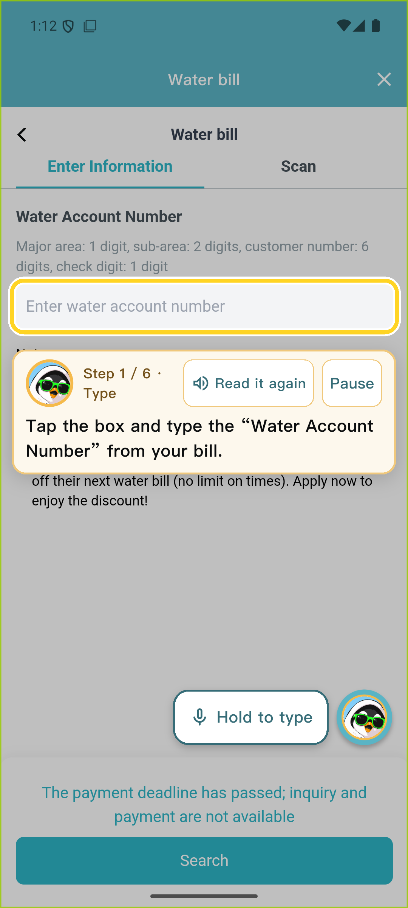</td>
    <td width="25%"></td>
    <td width="25%"></td>
  </tr>
</table>

- 9 種服務有教學：圖書借閱、繳費（15 種費用）、警政報案、區公所申辦、災情通報、陳情、臨櫃叫號、優惠券、訂閱。
- 任務卡寫這一步要做什麼（一行精簡重點，可展開）、光圈標出要按的地方，可朗讀、暫停；卡片會避開光圈目標與「下一步」按鈕。
- 打字的欄位**打完才算完成**（按 Enter、收起鍵盤或離開那一格才進下一步）。
- **非必填欄位也教**：沒有「*」的欄位，任務卡出現「跳過這格」，說或打「跳過」也可以；跳過的欄位這次教學不再回來。
- 頁面不修改、不打包，只在上面畫；最後一步永遠是使用者自己按，完成後說明「這是示範網站，沒有真的送出」。
- 教學流程在示範網站錄製操作後重播驗證（[tools/guide_audit/](tools/guide_audit/)）。

#### 4.3 按住輸入、按住選擇

- 教學要填欄位時，「按住提問」變成「**按住輸入**」：講的話轉成欄位格式填入（電話、Email、金額、日期、時間、身分證、車牌、地址、文字），可以「復原」。
- 教學在下拉、單選、勾選或清單的步驟時變成「**按住選擇**」：拿畫面上的選項（翻譯後的也算）比對講的話（正規化、包含、「第二個」這類序號、讀音相似）。
  有把握就直接選並顯示「已選『X』，可復原」；兩三個接近時列出讓使用者點；都不像就請他再說一次。單一的同意聲明勾選框一律留給使用者自己勾。
- 填欄位時講的內容不進對話紀錄、不送決策模型。

#### 4.4 語音地址分層比對

- 「台北市新義區市府路一號」→「臺北市信義區市府路1號」：縣市（22）→ 該縣市的區（368 個鄉鎮市區）→ 該區的路名（35,740 條）→ 段、巷、弄、號。
  每一層只在上一層的範圍內找，所以語音辨識的錯字在小範圍內對得回來；沒有把握的那一層照原文，不亂改。
- 警政報案、區公所申辦的「縣市／區／詳細地址」三格下拉：說一次地址，依序選好縣市、等區的選單載入後選區、再填詳細地址；可一次復原。
- 災情通報、陳情的地點欄位：整句校正成標準寫法後填入。

#### 4.5 台語自動辨識

- 不用切選單：語言判斷模型（Whisper tiny）的輸出上加了一個小分類器，分數夠高就交給台語模型 **Breeze-ASR-26**（聯發科技研究中心＋陽明交大，Apache-2.0）。
- 中文結果不像華語、或 App 認不出那句話時，也會交給台語模型再聽一次，留比較好的那份。
- 台語模型下載了但暫時不能用（記憶體不足、還沒啟動）時，不會用華語硬聽，而是說明原因；沒下載台語模型時照華語處理。目前只有辨識，朗讀用中文。

#### 4.6 多語介面與頁面即時翻譯

- 中文、台語、英、日、越、印尼、菲律賓文；講什麼語言，助理文字、建議句、教學卡片、按鈕、設定頁、App 畫面與服務網頁一起換。
- 預翻好的字串直接用，其餘用 Google ML Kit 離線翻譯；翻譯時保留原文，教學用原文找按鈕。
- 越南文的聲調與南北口音、印尼文的聊天縮寫、菲律賓文夾英文都有專門處理。外語文字目前是 AI 翻譯草稿，待母語者審閱。

#### 4.7 市府 FAQ、台北通常見問答

- 「大包垃圾要怎麼丟」「身分證掉了怎麼辦」→ 從市府常見問答 8,121 筆（e5 向量，手機上約 19 MB 索引）找答案；查詢前先把口語詞補成 FAQ 用詞。
- 台北通 App 本身的常見問題從台北通的常見問答找。這份資料在執行時從服務網站讀取（來源沒有標示授權，所以文字不存進 App 與 repo），答案下面可以直接開啟台北通的常見問答頁面。
- 分數夠高直接回答，接近時列出最接近的問題讓使用者選，以下不回答；答案照原文顯示、不經模型改寫，過長截斷並提示洽 1999。
- 問答來源登記在 [app/assets/assistant/qa_sources.json](app/assets/assistant/qa_sources.json)；新增或更新來源用 agent skill（[docs/QA_SKILL_GUIDE.md](docs/QA_SKILL_GUIDE.md)）。

#### 4.8 緊急回應

- 失火、冒煙、受困、倒地、沒呼吸、自殺、家暴、性侵、跟蹤等詞表（6 種語言），在所有檢索、FAQ、模型之前直接回 119／1925／1995／113／110；
  正在發生的暴力只回專線，失火會另外列出災情表單讓使用者選。不經模型，所以不會慢、不會被模型想歪。

#### 4.9 離線模型下載

- 第一次打開助理時問「下載離線助理（約 X GB）」，使用者同意才下載；依手機總記憶體分級，可暫停、續傳、檢查 SHA-256。
- 我們自己轉檔或訓練的檔案放在團隊的 Hugging Face [`allensung1226/townpass-assistant-models`](https://huggingface.co/allensung1226/townpass-assistant-models)。

#### 4.10 整包串接的微服務

- 助理套件不 import 台北通的任何程式；台北通實作主機介面 `PortalAssistantHost`（路由、開 WebView、首頁分頁、標題列），其他每個串接點只有幾行。
- 對官方檔案的改動從約 1,700 行減到約 250 行（新增 246、刪除 77，不含 4 個新增檔案）；完整列表見 [INTEGRATION.md](INTEGRATION.md) 與 [docs/HOST_CHANGES.md](docs/HOST_CHANGES.md)。
- 已在乾淨的官方台北通（`e65b586`）上只照串接文件套用，成功建置並在 Android 模擬器上跑起助理與教學。

## 5. 用 agent skill 擴充 / Extension

台北通的微服務會一直增加。為了讓接手的人不必先讀懂整個專案，我們把「加一個服務」和「加一個問答來源」各做成一個 agent skill：
把步驟、規則和自我檢查寫成 agent 照著做的操作手冊，再配上自動檢查與人工測試清單。在 repo 根目錄開啟 Claude Code，
複製說明書裡的 prompt 範本、把服務名稱和網址填進去，agent 就會一步步做完；人只要做最後的檢查與決定。

| | 新增或修改服務 `townpass-add-service` | 新增或更新問答來源 `townpass-add-qa` |
| --- | --- | --- |
| 適用情況 | 新的網頁服務、新的 App 原生頁、幫既有服務加教學、修改既有服務 | 市府 FAQ 的新版資料、微服務自己的問答、團隊寫的少量問答 |
| 要填的資料 | `capabilities.json` 一筆（名稱、關鍵字、需求說明、網址或原生路由）、5 種外語、口語例句；有表單的服務再加教學（步驟、頁面探針、6 種語言的卡片文字）與頁面預翻 | `qa_sources.json` 一筆（位置、授權、6 種語言的來源說明）、團隊寫的問答檔、開發題（正例與負例各 10 句以上） |
| 自動檢查 | `check_service.py`：目錄、6 種語言、例句數與重疊、網域白名單、路由、教學、預翻、評估案例、保留句、人工測試清單 | `check_qa_source.py`：登記表格式、授權與文字能不能存、網域、和評估集的重疊、e5 分數、保留題、人工測試清單 |
| 建議模型 | 有教學：Claude Opus 5.5 或 Fable 5.2；只加資料：至少 Claude Sonnet 5.5 | 市府 FAQ 新版：最高等級，而且擁有者在場；其他：至少 Claude Sonnet 5.5 |
| 說明書 | [docs/SKILL_GUIDE.md](docs/SKILL_GUIDE.md) | [docs/QA_SKILL_GUIDE.md](docs/QA_SKILL_GUIDE.md) |

- **不用改程式架構**：服務與問答都是資料。分類器的候選文字在執行時從目錄組出，新服務不必重訓就會被打分；
  但一定要量，新服務在開發集的「到得了」低於八成、或累積 5 個新服務時，才建議重訓（要擁有者同意）。
- **評估不倒退**：開發用的句子由 agent 自己寫；另請一位沒看過規則與例句的撰寫者寫保留句並封存，只用來報告。既有評估集的「開錯頁」不能增加。
- **給人照著點的測試清單**：最後產生 `MANUAL_TEST_<id>.md`，列出要說的句子、預期打開的頁面、教學每一步該看到什麼，讓人在手機上照著驗收。
- **演練過**：兩個 skill 都用假的服務、假的問答來源讓 Claude Sonnet 5.5 從頭照做，也故意逐步漏做，確認檢查抓得到；沒抓到的已補上檢查。
- **人要決定的事**：commit、push、加服務網域、上傳模型、判斷資料的授權，都要擁有者同意。服務網頁本身的開發（在 TownPass-Services）與正式 API 的授權不在 skill 的範圍內。

---

# 二、若使用 AI，需額外補充的項目（AI Usage Declaration）

## 1. 使用到的 AI 模型

**開發過程使用的 AI**

- Claude：Claude Code（Claude Opus 5.5），用於程式撰寫、測試、文件與翻譯草稿；版面與封面的設計也有用 Claude 協助。
- ChatGPT：少量使用，用來討論部分設計與實作方向；整體方向與功能由團隊自行構想與設計。
- Gemini：未使用。
- 影像生成：未使用 AI 影像生成；企鵝圖案沿用程式設計節提供的圖片。

**App 內實際執行的模型（自行架設／本地模型，全部在手機上執行）**

| 用途 | 模型與版本 | 開發者、授權 |
| --- | --- | --- |
| 決策（預設） | 決策分類器 v2（`townpass-decision-e5-ce-v2-q8_0.gguf`，由 multilingual-e5-small 微調的 cross-encoder，q8_0，132 MB） | 本專案訓練（基底 Microsoft），MIT |
| 語意檢索、FAQ 向量 | multilingual-e5-small（q8_0） | Microsoft，MIT |
| 語音辨識 | Whisper small（q8_0） | OpenAI，MIT |
| 語言判斷 | Whisper tiny（q8_0） | OpenAI，MIT |
| 台語辨識 | Breeze-ASR-26（q4_0） | 聯發科技研究中心、陽明交通大學，Apache-2.0 |
| 越南文辨識（Android） | PhoWhisper-base（q8_0） | VinAI，BSD-3-Clause |
| 決策（建置選項，預設不載入） | Ministral-3-3B-Instruct-2512（Q4_K_M）；Gemma 4 E2B（Q4_0，只有 Android） | Mistral AI，Apache-2.0；Google，Gemma 授權 |
| 頁面翻譯 | Google ML Kit on-device translation | Google |

選用原則：不使用中國開發的模型與工具；模型檔不放進 repo 或安裝檔，由使用者同意後下載。

## 2. 使用範圍

- **設計討論**：用 ChatGPT 與 Claude 討論部分設計與實作方向；產品方向、要做哪些功能與使用者體驗由團隊自行決定。
- **程式碼產生**：助理部分（`portal_assistant/` 與台北通上的串接點）約 90% 由 AI 產生，經人工審查與測試；官方台北通 App 原始碼不計。
  - App 端：引導教學、頁面探測、按住輸入／選擇、頁面翻譯、模型下載。
  - 後端：決策流程、檢索與比對、地址分層比對、HTTP 端點。
  - 原生：Android（Kotlin）與 iPhone（Swift）的模型伺服器啟動與生命週期。
- **文字生成**：README、規格、規則文件與開發紀錄；**英、日、越、印尼、菲律賓文的介面與教學文字是 AI 翻譯草稿**，尚待母語者審閱。
- **測試案例生成**：Python 與 Flutter 單元測試、widget 測試、教學流程重播測試；開發用評估句。
- **資料清洗與整理**：內政部路名資料、鄉鎮市區清單的整理腳本（[scripts/build_address_data.py](scripts/build_address_data.py) 等）；市府 FAQ 向量索引的建置腳本。
- **模型訓練**：決策分類器的訓練資料產生與微調流程。

## 3. AI 產生內容如何被驗證或修改

- **人工審查**：團隊對 AI 產生的程式與文件做大致的審查與測試，每次 commit 都經團隊成員同意。
- **規則先行**：所有行為規則寫在 [docs/AI_CURRENT_RULES.md](docs/AI_CURRENT_RULES.md)，每次改行為先改規則並寫明原因，再改程式。
- **自動測試**：Python 710 個、Flutter 1,043 個測試（助理套件 865、台北通 178）；教學流程在示範網站錄製後重播驗證；規則互相干擾由碰撞測試自動檢查。
- **評估集與封存保留集**：開發集用來調整；保留集由另一位撰寫者撰寫並封存，只用來報告，不拿來調規則；「開錯頁」必須維持不增加。
- **實機驗證**：Android 模擬器與實機（vivo）、iPhone 17／17 Pro Max 實測，問題記錄後修正再測。
- **安全**：WebView 只在服務網域上注入與讀取；後端只綁 `127.0.0.1`，檢查 Origin、Content-Type 與欄位白名單；模型檔下載後檢查 SHA-256。

## 4. 與 AI 相關的限制或風險

- **模型可能判斷錯誤**：語音辨識或決策可能聽錯、選錯頁面，所以只有把握夠高才直接開頁，其他情況列出選項讓使用者選；助理不替使用者送出、付款或同意。
- **台語與外語辨識仍有限制**：台語自動判斷約七成召回；外語介面文字是 AI 草稿，可能不自然或有誤。
- **AI 產生的程式碼可能遺留問題**：已用測試、評估與實機驗證降低風險，但無法保證沒有遺漏；Android 的 Release 版本與正式台北通環境尚未驗證（iPhone 實測用的是 release 建置）。
- **資料與授權**：示範用的服務網頁、mock 帳號與 JSON 不代表已取得正式台北通登入或政府 API 的授權；政府開放資料依授權條款註明出處。
- **FAQ 的時效**：市府 FAQ 有不少舊資料，答案以官方網站為準。
- **敏感資料**：App 的錄音不存檔、不上傳；開發過程中未將使用者個資、帳號密碼或未公開的金鑰輸入 AI。

---

# 三、串接到台北通

完整說明在 **[INTEGRATION.md](INTEGRATION.md)**：

- 最快的做法：把 `portal_assistant/` 放到台北通 repo 根目錄，執行 `portal_assistant/integration/apply.ps1`（或 `apply.sh`），再 `pub get`、`build_runner`。
- 主機介面 `PortalAssistantHost`：台北通的實作在 [integration/files/lib/util/town_pass_assistant_host.dart](integration/files/lib/util/town_pass_assistant_host.dart)。
- 24 個串接點（25 個 patch，語言頁兩個檔算一個串接點）：每個官方檔案一份 patch（[integration/patches/](integration/patches/)），文件逐一寫明位置、加什麼、為什麼、不加會怎樣。
- 台北通要提供的東西：服務網域（白名單 [app/assets/assistant/service_origins.json](app/assets/assistant/service_origins.json)）、WebView bridge（既有的訊息名稱與資料語意完全沒改）、建置開關、權限、模型下載來源、原生建置步驟。
- 對原台北通架構的修改：[docs/HOST_CHANGES.md](docs/HOST_CHANGES.md)。

# 四、專案結構與文件

| 位置 | 內容 |
| --- | --- |
| [INTEGRATION.md](INTEGRATION.md)、[integration/](integration/) | 串接文件、patches、要新增的檔案、套用腳本 |
| [app/](app/) | Flutter 套件 `townpass_portal_assistant`：引導助理、聊天面板、頁面翻譯、主機介面；資源與測試 |
| [backend/](backend/) | Python 後端：流程、檢索、決策分類器、語音與語言判斷、選項與地址比對、評估與測試 |
| [native/](native/) | Android（Kotlin、Gradle、原生伺服器建置）與 iPhone（建置與內嵌腳本） |
| [scripts/](scripts/) | 建置、推模型、評估、抽字串、資料整理、連結檢查 |
| [tools/](tools/) | 教學流程錄製與重播（guide_audit）、分類器訓練腳本（classifier）、翻譯審閱、煙霧測試 |
| [skills/](skills/) | agent skill：新增或修改服務（townpass-add-service）、新增或更新問答來源（townpass-add-qa）與人工測試範本 |
| [docs/](docs/README.md) | 規則、技術總覽、做法與實驗紀錄（[索引](docs/README.md)）；[docs/history/](docs/history/README.md) 是開發初期已被取代的計畫與報告，只當紀錄 |

| 主題 | 文件 |
| --- | --- |
| 行為規則（唯一準則） | [docs/AI_CURRENT_RULES.md](docs/AI_CURRENT_RULES.md) |
| 文件索引 | [docs/README.md](docs/README.md) |
| 技術總覽 | [docs/AI_TECHNICAL_OVERVIEW.md](docs/AI_TECHNICAL_OVERVIEW.md) |
| 決策分類器、FAQ | [docs/AI_DECISION_CLASSIFIER.md](docs/AI_DECISION_CLASSIFIER.md)、[docs/AI_FAQ_RAG.md](docs/AI_FAQ_RAG.md) |
| 語音、台語、多語 | [docs/AI_LANGUAGE_GATE.md](docs/AI_LANGUAGE_GATE.md)、[docs/AI_TAIWANESE_SPEECH_PLAN.md](docs/AI_TAIWANESE_SPEECH_PLAN.md)、[docs/AI_VIETNAMESE.md](docs/AI_VIETNAMESE.md)、[docs/AI_PAGE_TRANSLATION.md](docs/AI_PAGE_TRANSLATION.md) |
| 手機端、模型下載 | [docs/AI_ON_DEVICE_PLAN.md](docs/AI_ON_DEVICE_PLAN.md)、[docs/AI_ON_DEVICE_IOS.md](docs/AI_ON_DEVICE_IOS.md)、[docs/AI_MODEL_DOWNLOAD.md](docs/AI_MODEL_DOWNLOAD.md) |
| 地址資料 | [docs/AI_ADDRESS_DATA.md](docs/AI_ADDRESS_DATA.md) |
| 新增或修改服務（agent skill：建議模型、prompt、驗收） | [docs/SKILL_GUIDE.md](docs/SKILL_GUIDE.md)、[skills/townpass-add-service/SKILL.md](skills/townpass-add-service/SKILL.md)、[docs/NEW_SERVICE_HOLDOUT.md](docs/NEW_SERVICE_HOLDOUT.md) |
| 新增或更新問答來源（agent skill：授權、登記表、檢查、驗收） | [docs/QA_SKILL_GUIDE.md](docs/QA_SKILL_GUIDE.md)、[skills/townpass-add-qa/SKILL.md](skills/townpass-add-qa/SKILL.md)、[docs/NEW_QA_HOLDOUT.md](docs/NEW_QA_HOLDOUT.md) |
| 評估數字、手機速度與開發細節 | [docs/PROJECT_DETAILS.md](docs/PROJECT_DETAILS.md) |
| 開發指南、協作規範 | [ASSISTANT_README.md](../ASSISTANT_README.md)、[AGENTS.md](../AGENTS.md) |

# 授權與致謝

- 本 repository 的程式沿用上游 TownPass 的 [GPL-3.0](../LICENSE)；保留原作者與來源聲明。
- 模型檔不在 repo、不在安裝檔，授權依各模型（見上表與 [models.json](app/assets/assistant/models.json)）。
- 政府開放資料依「政府資料開放授權條款－第 1 版」使用並註明出處。
- 感謝臺北市政府資訊局開源的 [TownPass](https://github.com/taipei-doit/TownPass) 與 [TownPass-Services](https://github.com/taipei-doit/TownPass-Services)；
  資料：臺北市資料大平台、內政部戶政司、內政部國土測繪中心；
  模型與工具：OpenAI（Whisper）、Microsoft（multilingual-e5-small）、聯發科技研究中心與陽明交通大學（Breeze-ASR-26）、VinAI（PhoWhisper）、Mistral AI、Google（Gemma、ML Kit）、
  [llama.cpp](https://github.com/ggml-org/llama.cpp)、[whisper.cpp](https://github.com/ggml-org/whisper.cpp)、[Chaquopy](https://chaquo.com/chaquopy/)、Unihan 資料庫。
